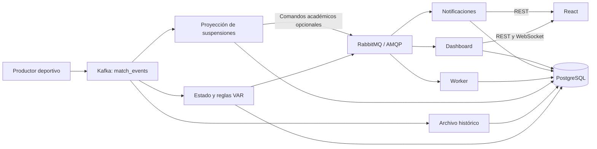

# Live-JVG · Eventos deportivos y VAR en tiempo real

Live-JVG procesa eventos deportivos, conserva el marcador confirmado y distribuye actualizaciones a una interfaz React. Cada microservicio tiene una responsabilidad propia y mantiene sus reglas de negocio separadas de las tecnologías de comunicación y persistencia.

## Arquitectura

El proyecto utiliza Java 17, Spring Boot, PostgreSQL, Apache Kafka, RabbitMQ y React con TypeScript.



Las conexiones opcionales del diagrama requieren habilitar sus propiedades y preparar sus esquemas. El resultado académico del worker no autoriza apuestas reales.

### Organización hexagonal

- **`domain`**: eventos, valores, agregados y reglas de negocio. No depende de Spring, JPA, Kafka ni RabbitMQ.
- **`application`**: casos de uso y puertos de entrada/salida. Coordina operaciones sin implementar transporte ni almacenamiento.
- **`infrastructure`**: controladores REST, WebSocket, clientes HTTP, adaptadores Kafka/AMQP, JDBC/JPA y configuración Spring.
- **`academic`**: integración académica opcional, separada de la autoridad del mercado.

Se tomaron como referencia de [HotelSpringBoot](https://github.com/daferarte/HotelSpringBoot/tree/d410557aeee75192f286772c914b65de2335cc8b) la separación de responsabilidades, la inyección por constructor y el comportamiento dentro del dominio. Live-JVG conserva su arquitectura de microservicios y no acopla el dominio a JPA.

## Guía de clases para la exposición

Las rutas enlazan directamente con las implementaciones.

| Microservicio | Clase y ubicación | Tecnología / responsabilidad |
|---|---|---|
| `live-feed-producer` | [KafkaMatchEventPublisher](services/live-feed-producer/src/main/java/com/live_jgv/live_feed_producer/infrastructure/kafka/KafkaMatchEventPublisher.java) | Kafka: publica eventos deportivos |
| `live-feed-producer` | [SimulationConfiguration](services/live-feed-producer/src/main/java/com/live_jgv/live_feed_producer/infrastructure/config/SimulationConfiguration.java) | Spring: compone el caso de uso |
| `match-state-service` | [KafkaMatchEventListener](services/match-state-service/src/main/java/com/live_jgv/matchstate/infrastructure/kafka/KafkaMatchEventListener.java) | Kafka: recibe los eventos del partido |
| `match-state-service` | [MatchState](services/match-state-service/src/main/java/com/live_jgv/matchstate/domain/model/MatchState.java) y [VarReviews](services/match-state-service/src/main/java/com/live_jgv/matchstate/domain/model/VarReviews.java) | Dominio: goles, anulaciones y revisiones VAR |
| `match-state-service` | [MessagingConfiguration](services/match-state-service/src/main/java/com/live_jgv/matchstate/infrastructure/config/MessagingConfiguration.java) | Spring Kafka y RabbitMQ: configuración y confirmaciones |
| `match-state-service` | [RabbitScoreUpdatePublisher](services/match-state-service/src/main/java/com/live_jgv/matchstate/infrastructure/rabbit/RabbitScoreUpdatePublisher.java) | AMQP: publica marcadores en `live_updates` |
| `match-state-service` | [LiveAlertOutboxDispatcher](services/match-state-service/src/main/java/com/live_jgv/matchstate/infrastructure/rabbit/LiveAlertOutboxDispatcher.java) | AMQP: publica alertas en `live_alerts` |
| `match-state-service` | [JdbcMatchStateStore](services/match-state-service/src/main/java/com/live_jgv/matchstate/infrastructure/jdbc/JdbcMatchStateStore.java) | PostgreSQL: estado, historial y outbox |
| `dashboard-backend` | [ScoreProjection](services/dashboard-backend/src/main/java/com/live_jgv/dashboard/infrastructure/jdbc/ScoreProjection.java) | AMQP y PostgreSQL: recibe y persiste marcadores |
| `dashboard-backend` | [MessagingConfiguration](services/dashboard-backend/src/main/java/com/live_jgv/dashboard/infrastructure/config/MessagingConfiguration.java) | RabbitMQ: exchange, cola, bindings y recuperación |
| `dashboard-backend` | [DashboardController](services/dashboard-backend/src/main/java/com/live_jgv/dashboard/infrastructure/web/DashboardController.java) y [WebSocketScorePublisher](services/dashboard-backend/src/main/java/com/live_jgv/dashboard/infrastructure/websocket/WebSocketScorePublisher.java) | REST y STOMP/WebSocket |
| `historical-archiver` | [ArchiveKafkaListener](services/historical-archiver/src/main/java/com/live_jgv/archiver/infrastructure/kafka/ArchiveKafkaListener.java) y [ArchiveConfiguration](services/historical-archiver/src/main/java/com/live_jgv/archiver/infrastructure/ArchiveConfiguration.java) | Kafka: consumo independiente del historial |
| `historical-archiver` | [JpaArchiveStore](services/historical-archiver/src/main/java/com/live_jgv/archiver/infrastructure/jpa/JpaArchiveStore.java) | JPA y PostgreSQL: eventos y comprobantes de entrada |
| `betting-suspension-service` | [SuspensionKafkaListener](services/betting-suspension-service/src/main/java/com/live_jgv/betting/infrastructure/kafka/SuspensionKafkaListener.java) y [MarketState](services/betting-suspension-service/src/main/java/com/live_jgv/betting/domain/MarketState.java) | Kafka y dominio: suspensión conservadora del mercado |
| `betting-suspension-service` | [AcademicRabbitSender](services/betting-suspension-service/src/main/java/com/live_jgv/betting/academic/AcademicRabbitSender.java) | AMQP: comandos académicos con confirmación |
| `betting-worker` | [WorkerRabbitListener](services/betting-worker/src/main/java/com/live_jgv/worker/infrastructure/amqp/WorkerRabbitListener.java) | AMQP: consumidor del contrato privado configurable |
| `betting-worker` | [AcademicWorkerListener](services/betting-worker/src/main/java/com/live_jgv/worker/academic/AcademicWorkerListener.java) y [AcademicTopologyConfiguration](services/betting-worker/src/main/java/com/live_jgv/worker/academic/AcademicTopologyConfiguration.java) | AMQP: cola académica, DLX y DLQ |
| `notification-backend` | [ScoreUpdateListener](services/notification-backend/src/main/java/com/live_jgv/notification/infrastructure/amqp/ScoreUpdateListener.java) y [RabbitConfiguration](services/notification-backend/src/main/java/com/live_jgv/notification/infrastructure/config/RabbitConfiguration.java) | AMQP: recepción, topología y ACK manual |
| `notification-backend` | [JdbcNotificationStore](services/notification-backend/src/main/java/com/live_jgv/notification/infrastructure/jdbc/JdbcNotificationStore.java) | PostgreSQL: deduplicación y guardado de alertas |
| `dashboard-frontend` | [dashboardStream](services/dashboard-frontend/src/services/dashboardStream.ts) y [useMatchCatalog](services/dashboard-frontend/src/hooks/useMatchCatalog.ts) | STOMP, recuperación y catálogo de presentación |

## Kafka: eventos y offsets

El productor publica JSON en el topic **`match_events`**, utilizando `matchId` como clave. Los eventos de una misma partición conservan su orden; no existe un orden global entre particiones.

| Consumer group predeterminado | Función |
|---|---|
| `match-state-service` | Actualizar el partido y sus reglas VAR |
| `historical-archiver` | Guardar el historial deportivo |
| `betting-suspension-service` | Proyectar las suspensiones del mercado |

Los consumidores desactivan **auto-commit** y utilizan confirmación **RECORD** con commits síncronos del contenedor después de procesar correctamente. Los fallos se propagan a las políticas de reintento y pausa. El productor utiliza `acks=all` e idempotencia de transporte; estas opciones no crean una transacción conjunta entre Kafka, PostgreSQL y RabbitMQ.

## RabbitMQ, AMQP y exchanges

**RabbitMQ** es el broker. **AMQP** es el protocolo utilizado por los productores y consumidores para publicar y recibir mensajes mediante exchanges, colas y bindings.

| Exchange | Tipo | Enrutamiento |
|---|---|---|
| `live_updates` | `topic` | Marcadores con routing key `score.<matchId>`; los bindings seleccionan partidos o patrones |
| `live_alerts` | `fanout` | Copia cada alerta a todas sus colas enlazadas; no filtra por routing key |
| `<queue>.dlx` | `direct` | Envía rechazos a `<queue>.dlq` mediante la routing key exacta `rejected` |
| Exchange predeterminado (`""`) | `direct` | El flujo académico publica a `betting_commands` utilizando el nombre de la cola |

El dashboard utiliza `mvp-dashboard-scores` en modo persistente y `dashboard.score-updates` en modo memory. Notificaciones utiliza `notification.score-updates`. El worker privado permite configurar su cola y exchange; no debe confundirse con el flujo académico.

Los productores que requieren custodia usan mensajes persistentes, `mandatory`, confirms y detección de returns. El dashboard y el worker académico utilizan ACK automático después del procesamiento. Notificaciones utiliza ACK manual después del commit o de una transferencia confirmada a DLQ. El inbox y las identidades de evento permiten detectar reentregas; la confirmación del broker no demuestra que otro microservicio haya completado su trabajo.

## Dominio y reglas VAR

- El marcador se calcula a partir de los goles aceptados y no anulados.
- Una anulación debe referenciar un gol activo del mismo partido.
- Un evento idéntico repetido no vuelve a modificar el marcador; reutilizar su ID con otro contenido es un conflicto.
- El flujo V1 abre VAR con `VAR_CHECK` y lo resuelve con continuación o anulación. El partido finaliza en el minuto 15 y con la revisión resuelta.
- `VarReviews` conserva las identidades de revisiones cerradas para impedir que una reentrega las reabra. Su correlación interna no activa automáticamente el protocolo V2.
- `MarketState` mantiene la suspensión ante evidencia insuficiente; recibir una continuación deportiva no autoriza por sí solo reabrir el mercado.

## Docker Compose único

[docker-compose.yml](docker-compose.yml) contiene la infraestructura, los siete microservicios Java y el frontend opcional. Las diferencias de entorno se expresan mediante variables de [.env.example](.env.example), sin un segundo Compose de AWS.

### Servicios, perfiles y puertos

| Servicio | Perfil | Puerto del host → contenedor |
|---|---|---|
| PostgreSQL | Base | `55434 → 5432` |
| Kafka | Base | `19092 → 19092`; internamente `kafka:9092` |
| RabbitMQ | Base | `5673 → 5672` AMQP; `15673 → 15672` administración |
| Productor | Base | `18081 → 8080` |
| Dashboard backend | Base | `18080 → 8080` |
| Estado del partido | Base | Sin puerto HTTP publicado |
| Archivo, suspensión y worker | `integration-prepared` | Sin puertos publicados |
| Notificaciones | `integration-prepared` | `18082 → 8082` |
| React / Nginx | `web` | `18083 → 8080` |

Todos los puertos publicados se enlazan a `127.0.0.1`. La red `default` de tipo bridge mantiene la comunicación por nombres de servicio. Se conservan los volúmenes `postgres_data`, `kafka_data` y `rabbit_data`, cuyo nombre físico depende del proyecto Compose. El dashboard mantiene una réplica porque su broker STOMP es local a la JVM; el worker conserva dos réplicas.

Los healthchecks condicionan las dependencias de arranque. `kafka-init` crea el topic después de que Kafka esté disponible. Los servicios de ejecución tienen reinicio `unless-stopped` y logs con rotación. Estos controles no sustituyen una prueba funcional completa.

### Ejecución local aislada

Requisitos: Docker Compose v2 con motor Linux, Java 17 y Maven para pruebas del backend; Node 24 para trabajar directamente con React.

1. Copiar `.env.example` a `.env` y completar `MVP_DB_PASSWORD` y `MVP_RABBIT_PASSWORD` con valores propios.
2. Validar la configuración antes de iniciar contenedores:

```bash
docker compose --profile integration-prepared --profile web config --quiet
```

3. Para un proyecto local nuevo, iniciar el núcleo y React:

```bash
docker compose -p live-jvg-presentacion --profile web up --build -d
```

4. Para incluir también los cuatro microservicios opcionales:

```bash
docker compose -p live-jvg-presentacion --profile integration-prepared --profile web up --build -d
```

El último comando incluye los contenedores, **pero no prepara todos sus esquemas ni activa sus consumidores**. JPA y las comprobaciones de disponibilidad necesitan los esquemas existentes. Las migraciones y roles de archivo, suspensión, worker y notificaciones se preparan por separado en la base aislada antes de habilitar sus procesos.

Las variables `ARCHIVER_CONSUMER_ENABLED`, `BETTING_CONTROL_CONSUMER_ENABLED`, `NOTIFICATION_STORAGE_ENABLED` y `NOTIFICATION_MESSAGING_ENABLED` controlan esas funciones. Los comandos académicos tienen sus propias variables `ACADEMIC_*`. Las migraciones opcionales se controlan por servicio mediante `<PREFIJO>_MIGRATIONS_ENABLED`; permanecen desactivadas por defecto. No habilitar aceptación o autoridad del worker para obtener únicamente una demostración académica.

La simulación automática requiere `SIMULATOR_AUTO_ENABLED=true` y una ronda iniciada mediante la operación existente. `SIMULATOR_RESET_KEY` protege esa operación. El intervalo efectivo sigue definido por `@Scheduled(fixedRate = 15_000)`; se conserva `SIMULATOR_AUTO_INTERVAL_MS` por compatibilidad, pero actualmente no controla ese scheduling.

El frontend se compila con `VITE_WS_URL` y `VITE_NOTIFICATION_ORIGIN`. Cambiar estas direcciones requiere reconstruir su imagen. Los contenedores se comunican por nombres internos; el navegador utiliza direcciones accesibles desde su propia máquina.

### Preparación para AWS EC2 y RDS

El mismo Compose admite `JVG_DB_MODE=external`: el servicio `postgres` comprueba la disponibilidad de la base externa y no inicia un servidor PostgreSQL local. Sus volúmenes locales se conservan, pero no se utilizan como almacenamiento de RDS.

Configurar `JVG_DB_HOST`, `JVG_DB_PORT`, `JVG_DB_NAME`, `JVG_DB_USER`, `JVG_DB_OPTIONS=?sslmode=require` y `JVG_PGSSLMODE=require`. El archivo de ejemplo conserva comentados el endpoint y los valores del antiguo overlay. Cada servicio también admite su URL específica, como `MATCH_STATE_DB_URL` o `ARCHIVER_DB_URL`, y sus usuarios correspondientes.

Los valores de alertas y simulación antes definidos en el overlay se encuentran en esa misma sección del archivo de ejemplo. Los siete partidos configurados en el estado se conservan en el Compose. Para notificaciones, `NOTIFICATION_AMQP_AUTO_STARTUP=true` reproduce su arranque explícito sin activar los listeners de otros servicios.

En EC2, un proxy HTTPS debe enrutar `/ws` y las APIs del dashboard hacia `18080`, `/api/alerts` hacia `18082` y, si se usa el frontend separado, la interfaz hacia `18083`. Configurar los orígenes permitidos y las URLs públicas HTTPS/WSS; no publicar los brokers en Internet.

Este repositorio prepara la configuración de despliegue: **no modifica el proxy, los secretos, los esquemas ni los servicios de la instancia productiva**. No ejecutar los comandos de demostración contra producción ni eliminar volúmenes para actualizar una instalación existente.

## Compilación y pruebas

Desde la raíz:

```bash
mvn -Pall-services verify
python scripts/validate-architecture.py
python scripts/test-architecture.py
python scripts/test-compose-consolidation.py
python scripts/validate-compose.py
npm --prefix services/dashboard-frontend ci
npm --prefix services/dashboard-frontend test
npm --prefix services/dashboard-frontend run build
node --test services/dashboard-backend/src/test/js/*.test.cjs
```

Los validadores Compose requieren las contraseñas locales definidas; sus pruebas de consolidación utilizan valores ficticios y solo ejecutan `config`. No imprimen la configuración resuelta, que puede contener secretos.

Sin perfil, Maven en la raíz solo valida el POM. `audit-services` selecciona tres servicios y `all-services` selecciona los siete; no utilizar ambos perfiles simultáneamente. Las pruebas externas conservan sus condiciones de activación y requieren recursos aislados.

GitHub Actions valida los servicios y clientes; no publica imágenes ni despliega. Los [contratos JSON](contracts/events) y la [guía de clon limpio](docs/CLEAN_CLONE.md) complementan esta explicación. Los documentos históricos describen sus revisiones originales y no certifican un despliegue actual.

### Estado conocido de la validación

La refactorización anterior verificó los siete servicios Java y la compilación React. Permanecen siete fallos previos en `LiveDashboardDurable.test.tsx` y `LiveDashboardAlerts.test.tsx`: el catálogo actual filtra identidades de rondas de presentación, mientras esas pruebas esperan IDs generales. No se cambiaron ese comportamiento ni las reglas de negocio para ocultar los fallos.

La entrega completa requiere además pruebas reales de Kafka, RabbitMQ y PostgreSQL, construcción de imágenes y pruebas de navegador. Si Docker o el navegador no están disponibles, esas comprobaciones deben reportarse como pendientes.
