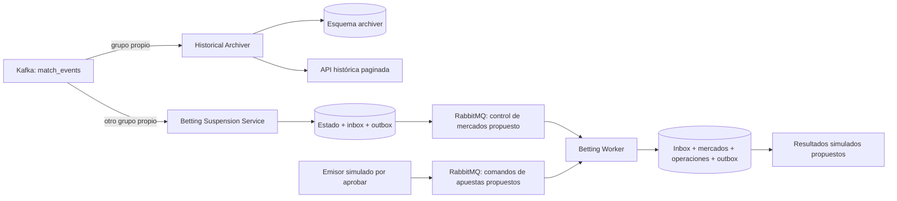

# DEV 3 — Fase 1: auditoría y diseño propuesto

Fecha: 2026-11-15, America/Bogota. Estado: **diseño para aprobación; sin implementación**.

## 1. Alcance y estado inspeccionado

Repositorio disponible: `/Users/valeriaestefaniagongoratorres/Live-JVG`; la ruta Windows indicada en la solicitud no es la de esta sesión. Rama: `integration/Valeria-mvp-dev`; HEAD observado: `d2128b7`, con padres `9d865f8` y `de7a076`. Al comenzar la auditoría el árbol estaba limpio y no había `MERGE_HEAD`. Ese commit preexistía a esta fase: no se hicieron commits, merges, push, stash ni resets.

Esta fase inspecciona y propone. No autoriza implementar servicios, cambiar contratos, dependencias o Compose ni ejecutar migraciones. La existencia del commit de integración no demuestra por sí misma la salud actual de los servicios.

## 2. Hallazgos comprobados

| Módulo | Clase principal real | Código y pruebas | Dependencias declaradas relevantes |
|---|---|---|---|
| historical-archiver | `com.live_jgv.archiver.HistoricalArchiverApplication` | Una clase principal y un `contextLoads` | Actuator, JPA, Kafka, Validation y driver PostgreSQL |
| betting-suspension-service | `com.live_jgv.betting.BettingSuspensionServiceApplication` | Una clase principal y un `contextLoads` | Actuator, AMQP y Kafka |
| betting-worker | `com.live_jgv.worker.BettingWorkerApplication` | Una clase principal y un `contextLoads` | Actuator y AMQP |

En los tres servicios, `application.properties` contiene únicamente `spring.application.name`. No existen listeners, dominio de apuestas, repositorios, APIs de negocio, migraciones ni configuración de brokers. `contextLoads` no demuestra integración ni persistencia y no se ejecutó en esta fase.

Los tres POM declaran Java 17 y parent Spring Boot **4.1.2**; los servicios del núcleo inspeccionados usan **3.5.7**. No se verificó disponibilidad remota ni compatibilidad del parent de DEV 3. Se propone alinear exclusivamente los tres módulos DEV 3 con la línea 3.5.7 que usa el núcleo, previa aprobación; no cambiar versiones para ocultar fallos de red. Revisar también los artefactos starter/test declarados, pues no basta con reemplazar el número del parent.

Herramientas observadas: Maven 3.10.0; `java -version` predeterminado informa Java 25 y `mvn -version` informa Java 27. El ejecutable de Temurin 17 instalado informa 17.0.20.1. Para futuras verificaciones deben fijarse `JAVA_HOME` y `PATH` a Temurin 17 y confirmar nuevamente `mvn -version`.

Los cuatro archivos de `contracts/events/` tienen **0 bytes**: `match-event.schema.json`, `score-update.schema.json`, `betting-command.schema.json` y `live-alert.schema.json`. No equivalen a contratos aprobados.

### Fuentes consultadas

- POM, clases principales, propiedades, wrappers y pruebas de los tres módulos DEV 3.
- [Propuesta local de MatchEvent](../services/live-feed-producer/docs/match-event-contract-proposal.md) y su JSON Schema propuesto adyacente.
- `live-feed-producer/.../domain/model/MatchEvent.java` y `infrastructure/kafka/KafkaMatchEventPublisher.java`.
- `match-state-service/.../domain/model/MatchEvent.java`, `ScoreUpdate.java`, `entrypoint/kafka/KafkaMatchEventListener.java`, `infrastructure/config/MessagingConfiguration.java` y `infrastructure/rabbit/RabbitScoreUpdatePublisher.java`.
- Propiedades de Kafka/RabbitMQ/PostgreSQL del consumidor; [Compose actual](../docker-compose.yml) y POM raíz.
- [Diseño de fiabilidad existente](phase-7g-reliability-design.md), para reutilizar el patrón inbox/outbox sin alterar servicios ajenos.

## 3. Contratos observados y compatibilidad

### Entrada deportiva existente, todavía provisional

Kafka: topic `match_events`; clave de registro igual a `match_id`. El publicador utiliza `event.matchId()` como clave y serialización JSON `snake_case`. No reutilizar el grupo `match-state-service`: cada servicio DEV 3 debe tener su propio grupo para recibir todos los eventos.

| Campo JSON | Tipo observado | Regla actual del dominio |
|---|---|---|
| event_id | string no vacío | Identidad preservada durante replay; no exigir UUID: el constructor admite IDs no UUID |
| match_id | string no vacío | Debe coincidir con la clave Kafka |
| event_type | string enum | GOAL, VAR_CHECK, GOAL_ANNULLED, MATCH_CONTINUES |
| team_id | string o null | Obligatorio y no vacío para GOAL |
| minute | integer | 0..130, restricción provisional del simulador |
| timestamp | string fecha/hora | Representable como Instant; preservar precisión original |
| reference_event_id | string o null | Obligatorio y no vacío para GOAL_ANNULLED; identifica al GOAL original |

La propuesta local exige `event_id`, `match_id`, `event_type`, `minute` y `timestamp`; condiciona equipo/referencia al tipo. No exige referencia para todos los VAR_CHECK ni para MATCH_CONTINUES. DEV 3 no debe endurecer unilateralmente esas reglas ni asumir que el timestamp establece orden total. Validar JSON y tipos antes de construir DTO; no convertir silenciosamente cadenas numéricas, enum desconocidos o números fraccionarios.

Identidad de negocio propuesta: `(match_id,event_id)`, conservando el contenido canónico para detectar colisiones. Identidad de transporte distinta: `(source_id,topic,partition,offset)`, incluyendo identidad estable de la fuente/log para evitar confundir un topic recreado con el anterior. La igualdad exacta de payload y la política ante campos futuros requieren aprobación. Retener bytes originales aunque se normalice JSON para comparar semántica.

### Salida deportiva existente

RabbitMQ: exchange `live_updates`, tipo `topic`, routing key `score.{matchId}`. Campos de `ScoreUpdate`: `match_id`, `home_score`, `away_score`, `event_id`, `event_type`, `updated_at`, `var_status`, `reference_event_id`; estados VAR existentes `CLEAR` e `IN_PROGRESS`. El publicador actual envía JSON persistente con `message_id=event_id`, mandatory y confirms.

No reutilizar este exchange ni añadir campos de apuestas a ScoreUpdate sin acuerdo. DEV 3 no debe tratar `var_status=CLEAR` de una anulación como autorización automática para reabrir apuestas. Para suspensión se recomienda el flujo deportivo Kafka, conservando la semántica de cada evento.

## 4. Arquitectura propuesta

Usar Java 17, Spring Boot, Kafka, RabbitMQ, PostgreSQL y Flyway existentes; no añadir Redis, CDC ni otro broker. Separar dominio, casos de uso y adaptadores. No importar clases Java de DEV 1/DEV 2 como dependencia entre microservicios: mapear DTO de transporte locales y fijar fixtures compatibles con el formato acordado.

Cada servicio es dueño de su esquema y migraciones: `archiver`, `betting_control` y `betting_worker` son **nombres propuestos**. Una misma instancia PostgreSQL sirve para el alcance MVP, con usuarios/permisos por esquema y sin escrituras directas a tablas de otro servicio. No ejecutar Flyway durante esta fase. El arranque futuro debe detenerse si no hay persistencia; no degradarse silenciosamente a memoria.

## 5. Historical Archiver — diseño para Fase 2

- Consumir `match_events` con grupo propio propuesto `historical-archiver`. `enable.auto.commit=false`; confirmar offset únicamente después del commit PostgreSQL de evento o cuarentena.
- `archived_event`: identidad `(match_id,event_id)`, tipo, equipo, minuto, instante original, referencia, contenido validado, hash canónico y fecha de ingestión. El timestamp no sustituye la identidad ni el orden Kafka.
- `input_receipt`: fuente, topic, partición, offset, timestamp del registro, bytes de clave/valor, headers, resultado y vínculo al evento/caso. Permite auditar reentregas y datos malformados.
- `invalid_event`: causa clasificada, referencia al recibo, estado de revisión y trazabilidad. Un evento inválido solo permite avanzar Kafka cuando su evidencia está confirmada en PostgreSQL. Si la DB falla, mantener offset pendiente y pausar/reintentar con espera; nunca saltar silenciosamente.
- Duplicado idéntico: no insertar otro evento; conservar su recibo de transporte. Mismo ID con contenido diferente: cuarentena `IDENTITY_CONFLICT`, sin reemplazar el registro original.
- Anulación antes del gol: archivar el hecho válido sin inventar causalidad ni modificarlo. La ausencia temporal de una referencia es una observación de auditoría, no JSON malformado; no bloquear la partición esperando al gol. La validación de marcador pertenece a match-state-service.
- API propuesta: `GET /api/history/matches/{matchId}/events?limit=50&after=<cursor>`. Cursor opaco sobre secuencia de ingestión por partido, límite máximo propuesto 200, filtros de tipo opcionales, orden estable y cursor siguiente. No exponer bytes/headers privados en la API pública. Es un endpoint futuro, no existe hoy.
- Flyway: preparar V1 con tablas, restricciones e índices; JPA con `ddl-auto=validate` si se mantiene JPA. No habilitar actualizaciones automáticas de esquema.

La identidad y el archivo deben sobrevivir reinicios; offsets Kafka solos no sustituyen la DB. Kafka puede eliminar mensajes por retención: el archivo durable debe tener política de backup/retención aprobada, sin asumir que un replay completo siempre será posible.

## 6. Betting Suspension Service — decisiones de negocio pendientes

Consumir Kafka con grupo independiente propuesto `betting-suspension-service`. En una transacción: recibo/idempotencia, transición de mercado, versión monotónica por partido y outbox de la transición efectiva. Conservar relación con el evento deportivo causante. Publicar estado resultante completo, no una orden ambigua de tipo toggle.

| Estado actual | Evento | Transición propuesta, no aprobada |
|---|---|---|
| UNKNOWN | Cualquiera | Mantener bloqueado hasta inicialización autorizada; no inferir apertura de un GOAL |
| OPEN | VAR_CHECK | SUSPENDED; registrar revisión pendiente |
| SUSPENDED | VAR_CHECK duplicado | Sin nueva transición ni nueva versión |
| SUSPENDED | GOAL_ANNULLED | Registrar decisión; permanecer SUSPENDED |
| SUSPENDED | MATCH_CONTINUES | OPEN solo si la política aprobada permite cerrar todas las revisiones pendientes |
| OPEN | GOAL | Registrar hecho; sin cambio automático de apertura |
| Cualquiera | Mensaje inválido/ID conflictivo | Cuarentena; no alterar estado de negocio |

Varias revisiones simultáneas, VAR_CHECK sin referencia y MATCH_CONTINUES sin referencia no pueden resolverse con certeza solo con el contrato actual. Ante ambigüedad se propone permanecer SUSPENDED y requerir resolución auditada. El equipo debe aprobar cómo correlacionar y cerrar revisiones. No inventar reapertura automática, cancelación de apuestas ni liquidación por goles anulados.

Persistencia propuesta: `market_state`, `processed_event`, `input_receipt`, `review_case`, `outbox`. Bloquear fila por partido o aplicar revisión optimista; transición y outbox atómicas. Reintentos transitorios acotados por ciclo, con pausa/cooldown sin descartar datos; errores permanentes con evidencia durable.

## 7. Betting Worker — diseño para Fase 4

Consume comandos simulados y actualizaciones de estado aprobadas, con colas propias. No consume ni compite por colas del dashboard. No hay actualmente un emisor de comandos implementado: proponer un emisor de prueba aislado, sin modificar el productor deportivo.

Nombres de exchanges/colas/routing keys, y todos los campos de apuestas siguientes, son propuestas locales **sin contrato aprobado**. Aprobar antes de crear topologías o código:

| Mensaje propuesto | Campos mínimos para discutir |
|---|---|
| MarketStateChanged | message_id, schema_version, match_id, market_version, state, source_event_id, occurred_at |
| PlaceSimulatedBet | command_id, schema_version, bet_id, match_id, selection_id, simulation_units, expected_market_version, created_at |
| SimulatedBetResult | message_id, command_id, bet_id, match_id, status, reason_code, market_version, processed_at |

IDs string no vacíos; versiones enteras positivas; fechas RFC 3339. `simulation_units` sería entero positivo sin equivalencia monetaria. Límite, selección válida, reglas de cuotas y uso de unidades requieren aprobación; no modelar saldos reales, pagos ni ganancias. No imponer estos campos a los contratos actuales.

Estados propuestos de operación: RECEIVED → ACCEPTED, REJECTED o HELD. Mercado UNKNOWN/SUSPENDED o versión incierta: HELD o rechazo según política a aprobar; nunca ACCEPTED por defecto. Reenvío idéntico de `command_id`: devolver/republicar resultado persistido sin ejecutar de nuevo. Mismo ID con otro contenido: conflicto auditable. Una segunda orden con distinto command_id pero el mismo bet_id no crea otra apuesta: aplicar restricción de negocio y política explícita.

Persistir `command_inbox`, `market_projection`, `simulated_bet`, `operation_result`, `outbox` y cuarentena. Bloqueo por partido para serializar cambio de estado y aceptación local. El commit de inbox/resultado/outbox precede al ack Rabbit; publicar resultado desde outbox con confirms/returns. Un timeout de confirmación implica resultado incierto: reintentar la misma identidad y deduplicar en destino, sin prometer exactly-once entre DB y Rabbit.

### Límite crítico de orden y suspensión

Kafka y RabbitMQ no proporcionan un orden total compartido. Dos colas independientes de control/apuestas, aun con un consumidor cada una, tampoco lo garantizan. `expected_market_version` detecta desfases observados, pero **no demuestra que no haya un VAR todavía en tránsito**.

Para el MVP se propone una cola de ejecución del worker para los dos tipos de entrada, un consumidor y prefetch=1, con versiones de control y estado UNKNOWN cerrado tras arranque hasta sincronizar. Si la topología definitiva exige varias colas/instancias, el bloqueo DB sigue siendo obligatorio. El outbox de control no adelantará una versión posterior al confirmar una anterior; si llega un salto, mantener bloqueado y recuperar estado. Versiones anteriores se ignoran solo tras comprobar identidad y trazabilidad.

La garantía propuesta es aceptación según el último control confirmado que el worker ha aplicado, **no suspensión instantánea en el instante físico del VAR**. Las órdenes concurrentes antes de recibir la suspensión requieren una política aprobada: revisión/retención o aceptación según orden observado. Si se exige garantía estricta entre todos los hechos y apuestas, hará falta una autoridad única que secuencie ambos o un protocolo de autorización con fencing; excede el ajuste mínimo y necesita diseño/aprobación adicional. Una consulta HTTP de estado por sí sola no elimina esa carrera.

## 8. Errores, reintentos y seguridad

- Malformados, enum/tipos inválidos, clave Kafka divergente e identidad conflictiva: conservar evidencia y clasificar; no bucle infinito sobre el mismo registro sin supervisión.
- Errores DB/broker transitorios: no confirmar antes de persistir. Backoff acotado por ciclo, estado visible y recuperación sin pérdida. Al agotar intentos, DLT/quarantena solo si su publicación/almacenamiento está confirmado; en caso contrario retener/pausar.
- Rabbit: colas durables, mensajes persistentes y publisher confirms; no inferir durabilidad de una cola solo por el exchange. DLT, TTL y política de replay deberán aprobarse. No confiar en que los mensajes reentregados mantengan siempre el orden.
- Replay explícito con actor, motivo, identidad de intento y revisión esperada; no cambiar el payload original ni crear un evento deportivo ficticio. Para suspensión/apuestas, reproducir un hecho antiguo no debe deshacer una decisión posterior: distinguir reconstrucción desde inicio y replay operativo.
- No registrar credenciales, payloads sensibles ni headers completos en logs. Acceso restringido a evidencias raw y a consultas administrativas; secretos por entorno/archivo local ignorado. Mantener esquemas DEV 1/DEV 2 intactos.

## 9. Plan de pruebas y criterios de aceptación

| Fase | Pruebas propuestas | Criterio para avanzar |
|---|---|---|
| 1 — auditoría | Inspección XML, inventario Java, tamaño de contratos, lectura de adaptadores y Compose | Diseño revisado; contratos y decisiones pendientes identificados |
| 2 — archiver | JSON snake_case real; claves/IDs; duplicado y colisión; transacción y rollback; anulación fuera de orden; paginación; reinicio | Un evento único por identidad, recibos auditables y offset confirmado solo tras commit; historial estable |
| 3 — suspensión | Tabla de transiciones aprobada; duplicados; varias revisiones; orden distinto; invalidación; reinicio; outbox incierto | Ningún inválido cambia el mercado; no reapertura prematura; transición durable única |
| 4 — worker | Duplicado de command_id/bet_id; suspendido/desconocido; versiones obsoletas/saltos; concurrencia; commit antes de ack; reinicio | No aceptación con estado local bloqueado; una operación lógica y resultado recuperable |
| 5 — real, con permiso separado | Brokers/DB reales, Flyway, reinicios, reentregas, VAR y continuación, frontend/API histórica | Evidencias de Kafka → persistencia/control → Rabbit → worker; límites de orden explícitos |
| 6 — entrega | Dockerfiles, propuesta Compose, documentación de APIs y topologías, fixtures y lista de cambios | Revisión reproducible; sin secretos; permisos para despliegue y PR separados |

Pruebas unitarias sin herramientas externas; persistencia únicamente en PostgreSQL dedicado con usuario/esquema/DB exclusivos. Las pruebas reales deben comprobar antes del arranque que redes, volúmenes, puertos, grupos y colas no coinciden con los existentes. Exportar Compose con otro nombre de proyecto no basta si conserva nombres explícitos de red/volumen. No interrumpir brokers compartidos para probar resiliencia.

En esta fase no se ejecutaron suites Maven, brokers, SQL, Flyway, Docker ni pruebas de negocio. Se ejecutó únicamente inspección estática con `rg`, lectura de archivos, parseo XML, tamaños de contratos y versiones de herramientas. Resultado real: tres esqueletos, tres pruebas básicas declaradas y cuatro contratos vacíos. No se afirma que compilen ni que sus pruebas pasen.

## 10. Dependencias y aprobaciones

1. DEV 1 y equipo: aprobar la propuesta MatchEvent, identidad, campos opcionales, compatibilidad futura y política de retención/replay. No modificar contratos compartidos desde DEV 3.
2. Responsable del proyecto: aprobar Java 17/Boot 3.5.7 para DEV 3 y ajustes de dependencias necesarios: web/validación para API histórica, JDBC o JPA, PostgreSQL y Flyway; Spring Kafka/AMQP según el módulo. Elegir JDBC para los nuevos modelos de suspensión/worker evita añadir JPA donde no se necesita.
3. Negocio/equipo: aprobar apertura inicial, resolución de revisiones ambiguas, tratamiento de órdenes en tránsito, HELD frente a REJECTED, criterios de reanudación y selección válida. No existe autorización para liquidación económica.
4. Equipo: aprobar esquemas de comandos/resultados/control y topologías Rabbit nuevas; routing por partido, contratos versionados y estrategia de sincronización. DEV 2 conserva sus endpoints, WebSocket y colas.
5. Infraestructura: autorizar por separado DB/esquemas/usuarios, ejecución de migraciones y pruebas reales en entorno dedicado. Solo preparar archivos de migración en la implementación futura.
6. Usuario: aprobar iniciar Fase 2. No implica aprobar automáticamente reglas de apuestas ni habilitar Fases 3–5.

## 11. Informe obligatorio de esta fase

- **Trabajo realizado:** auditoría de tres módulos, contratos, modelos y configuración real del núcleo; arquitectura y plan de pruebas propuestos.
- **Archivos modificados:** únicamente este documento. Código fuente, POM, Compose y contratos permanecen intactos durante esta fase.
- **Funcionalidades completadas:** ninguna de producción; entregado el diseño. Los tres servicios siguen siendo esqueletos.
- **Pruebas/resultados:** solo verificaciones estáticas y versiones, descritas arriba; ninguna prueba funcional ejecutada.
- **Riesgos:** contratos vacíos, divergencia de dependencias, carrera entre control y apuestas, datos inválidos que bloquean particiones y reentregas tras confirmación incierta.
- **Dependencias:** aprobaciones de contrato/negocio y entorno PostgreSQL/brokers aislado.
- **Próxima fase:** Historical Archiver con pruebas y migraciones preparadas, sin ejecutarlas en DB real.
- **Autorización necesaria:** aprobar el diseño de archiver, la línea de dependencias y el inicio de Fase 2; no iniciar implementación hasta recibirla.
