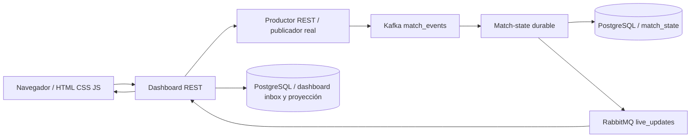

# Live-JVG — Informe final del MVP

Fecha de trabajo: 2026-11-14, America/Bogota. **Estado: PASS del MVP local.**
Aplicación levantada y comprobada en http://localhost:18080.

No se presenta como terminado todo el producto: el MVP incluye tres microservicios
esenciales y una interfaz real. Los cuatro servicios secundarios permanecen como
esqueletos y no forman parte de esta demostración.

## 1. Auditoría rápida y alcance elegido

Al comenzar no existía frontend. dashboard-backend tenía clase de arranque y POM
de esqueleto Boot 4.1.2; Compose contenía services vacío. El productor tenía dominio
y adaptador Kafka, pero controlador vacío y simulador sin implementación. El núcleo
match-state-service ya disponía de las garantías 7H/7I, que se conservaron.

Se completó el camino mínimo sin una nueva plataforma frontend ni Node en runtime:



La interfaz consulta su propio origen cada 900 ms. No se usa polling a una API
falsa ni acceso del navegador a Kafka: los snapshots proceden del consumo real
RabbitMQ del dashboard. No se implementó WebSocket porque no es necesario para
el objetivo funcional y habría añadido complejidad al plazo.

## 2. Componentes funcionando

| Componente | Estado real | Acceso local |
|---|---|---|
| Dashboard + frontend | UP/healthy; recibe RabbitMQ y persiste inbox/proyección | http://localhost:18080 |
| live-feed-producer | UP; REST invoca KafkaMatchEventPublisher real | http://localhost:18081 |
| match-state-service | UP; grupo Kafka estable, estado/outbox/cuarentena 7H/7I | Sin HTTP público |
| Kafka 3.9.1 | Healthy; topic match_events, una partición | localhost:19092 |
| RabbitMQ 4-management | Healthy; exchange topic live_updates y cola durable | AMQP 5673; management 15673 |
| PostgreSQL 17 | Healthy; esquemas separados match_state/dashboard | localhost:55434 |
| kafka-init | Exited 0, ejecución esperada de provisionamiento idempotente | Sin servidor permanente |

Proyecto Compose: **live-jvg-mvp**, con volúmenes PostgreSQL, Kafka y RabbitMQ
propios. Los puertos se publican solo en 127.0.0.1. No se reutiliza el partido ni
la cola de ninguna fase histórica. No se cambió de rama:
feature/Valeria-infra-history.

notification-backend, historical-archiver, betting-suspension-service y
betting-worker no se incluyeron: se inspeccionaron sus esqueletos, se conservaron
sin cambios y no se afirma que sus funcionalidades estén implementadas.

## 3. Funcionalidades disponibles

- Partido configurado y persistente, con equipos local/visitante; lista/selector
  del partido en la interfaz. No hay creación dinámica de catálogo desde la web.
- Generar goles de ambos equipos, indicar minuto, revisar un gol activo con VAR,
  anularlo y continuar el partido.
- Referencias al gol original conservadas, UUID nuevo por acción e identidad
  estable al repetir exactamente una solicitud con event_id/timestamp propios.
- Confirmación HTTP 202 únicamente después de confirmación Kafka. El frontend
  muestra envío pendiente hasta observar el ID en la proyección RabbitMQ.
- Marcador, estado VAR, goles activos e historial con IDs/referencias reales.
- Persistencia canónica y recuperación de match-state de 7H/7I, sin republicar
  todo el historial al arrancar.
- Inbox durable de dashboard: identidad `(match_id,event_id)`, efecto y recibo
  en una transacción. Un duplicado idéntico no sobrescribe el marcador; contenido
  distinto con igual ID se rechaza. Consumo serial, prefetch=1.
- Errores HTTP visibles; partido desconocido, equipo ajeno, referencia no activa
  y minuto inválido no se presentan como eventos procesados correctamente.

Endpoints nuevos del MVP:

| Servicio | Endpoint | Resultado |
|---|---|---|
| Dashboard | GET / | Interfaz |
| Dashboard | GET /api/matches | Catálogo/proyección persistida |
| Dashboard | GET /api/matches/{id} | Snapshot, eventos y goles activos |
| Dashboard | POST /api/matches/{id}/events | Valida y reenvía al productor real |
| Productor | POST /api/matches/{id}/events | Publicación Kafka confirmada o error |
| Ambos servicios web | GET /actuator/health | Salud HTTP |

La solicitud REST de evento incluye event_type, team_id, minute,
reference_event_id y, para identidad estable del cliente, event_id y timestamp
juntos. El navegador genera esos dos campos; no genera un ID nuevo al recibir
una actualización. No se añadieron campos al contrato Kafka/RabbitMQ existente.

## 4. Flujo probado en navegador real

Chromium headless real mediante Playwright instalado fuera del repositorio;
viewport desktop 1440×1000 y móvil 390×844. Se pulsaron los botones de la página,
sin simular las confirmaciones de brokers ni interceptar respuestas con mocks.

Partido aislado: `mvp-da3661c5-5556-45f2-aa19-961a4b454eca`.

| Acción UI | event_id observado | Resultado visible |
|---|---|---|
| Gol local | 88937e7c-a4b4-4790-b967-ed6fece24ed7 | 1–0, CLEAR |
| Revisión VAR | bd75cbc4-f807-47f3-b147-050f6cdbbba2 | 1–0, IN_PROGRESS |
| Anulación | d7e838a8-647b-4bc7-80a1-a694a25a8d6e | 0–0, CLEAR |
| Continuación | e1eec4c9-4219-40b9-abd0-0d30ddeeee35 | 0–0, CLEAR |
| Gol visitante | 4ee30c97-3bd2-4cfc-9297-f973f96de151 | 0–1, CLEAR |

La revisión y anulación referencian el primer gol. Se verificó cada respuesta
202, su ID en el historial recibido, el marcador DOM y VAR. La recarga de página
conservó datos; no hubo errores JavaScript ni overflow horizontal en móvil.

Después se reconstruyó/reinició únicamente dashboard y match-state del MVP.
Se conservaron 0–1 y los cinco eventos. Se reenvió por REST el gol visitante con
su mismo ID/timestamp: seis ocurrencias Kafka, cinco aplicaciones y cinco salidas.
Se publicó además una copia real del snapshot por RabbitMQ; el broker registró
su ack y la inbox siguió en cinco, con marcador idéntico.

Finalmente se ejecutó el script reproducible con cinco IDs nuevos sobre el mismo
partido, sin resetear datos: 1–1 → 1–1 en revisión → 0–1 → 0–1 → **0–2**.
La interfaz se volvió a comprobar después. Por eso la aplicación se entrega
actualmente con diez eventos únicos y marcador 0–2, no con datos vacíos.

## 5. Evidencia final de comunicación y persistencia

Inspecciones directas realizadas dentro del proyecto Docker MVP:

- Kafka: once registros, claves iguales al match_id, JSON snake_case y referencias
  originales; diez IDs únicos más la reentrega REST del ID ya aplicado.
- Grupo match-state-service: CURRENT-OFFSET=11, LOG-END-OFFSET=11, LAG=0.
- Ledger: revisión 10, diez eventos aceptados, once recibos de entrada.
- Outbox: diez publicaciones confirmadas, cero pendientes.
- Cuarentena: cero; los eventos de demostración fueron válidos.
- Dashboard: diez filas únicas de inbox; proyección 0–2, CLEAR, en PostgreSQL.
- RabbitMQ: cola de dashboard durable, consumidor activo y mensajes drenados.
- Los tres servicios esenciales permanecen levantados y conectados.

La prueba de reinicio de esta misión conserva el mismo volumen, catálogo y grupo;
no se hizo down -v, reset de offsets ni importación manual del marcador. Se
comprobó también que el script de arranque se puede repetir con los datos existentes
y termina con la URL cuando el grupo Kafka está estable.

## 6. Compilación, pruebas y comprobaciones

| Verificación de esta misión | Ejecutadas | Fallos/errores | Observaciones |
|---|---:|---|---|
| Productor Maven | 45 | 0 / 0 | 43 existentes + dos del simulador |
| Dashboard Maven | 3 | 0 / 0 | API/proyección, equipo ajeno y partido inexistente |
| Núcleo Maven sin fixtures opt-in | 78 | 0 / 0 | 98 casos reportados, 20 omitidos por no habilitar SQL/brokers históricos |
| Navegador completo | Cinco acciones + recarga/responsive | PASS | APIs y brokers reales |
| Reenvío REST y duplicado AMQP | Dos escenarios | PASS | Sin doble efecto ni regresión de snapshot |
| HTTP inválido | Cuatro escenarios | PASS | 404 y 400 esperados; no eventos falsos |
| Script check-mvp.py | Lectura y --publish | PASS | Cinco eventos nuevos, resultado esperado relativo al marcador inicial |
| start-mvp.sh final | Arranque idempotente real | PASS | Compila, provisiona y espera HTTP/grupo Kafka |
| Sintaxis JS/shell/Python y diff | PASS | Sin errores | node --check, bash -n, compile y git diff --check |

Son **126 pruebas Maven realmente ejecutadas** en la compilación estándar actual,
sin fallos; no se incluyen las 20 omitidas como éxitos. No se repitieron las suites
SQL/brokers extensas del núcleo, pues su código no cambió en esta misión. Su
ejecución previa completa de 102 casos en 7I permanece como evidencia histórica
intacta, no como una nueva ejecución de esos tests. El flujo real de esta misión
verifica la nueva integración y configuración Docker del núcleo.

Los tests unitarios pueden usar Mockito; la demostración UI y las comprobaciones
de mensajes, persistencia y reentregas usan servidores reales.

## 7. Problemas encontrados y correcciones

1. No existía frontend ni endpoints del simulador: se implementaron usando el
   publicador real y una interfaz estática local en dashboard.
2. Dashboard era un esqueleto Boot 4.1.2: se alineó con Java 17/Boot 3.5.7 y los
   starters reales de los servicios existentes. No se cambió la versión del núcleo.
3. JAR no accesible por el usuario no privilegiado del contenedor: el primer
   intento heredó permisos del umask de generación de secretos. Se aisló ese
   umask y Docker COPY fija propietario/permisos de lectura; no se ejecutan las
   aplicaciones Java como root para eludirlo.
4. Nombre acentuado mal leído en .properties: se corrigió con escape Unicode y
   actualización segura de nombres de presentación, sin alterar equipos, IDs,
   marcadores o historial. Se volvió a capturar la interfaz y comprobar el texto.
5. Riesgo de credenciales nuevas sobre volumen existente: el arranque se niega
   a regenerarlas si falta local.env y ya existe el volumen PostgreSQL del MVP.
6. La compilación Python de comprobación quiso escribir en caché global no
   permitida: se usó comprobación de sintaxis sin caché y se ejecutó el script
   realmente. No era un error de la aplicación.

## 8. Archivos modificados en esta misión

- Raíz: docker-compose.yml, Dockerfile nuevo, .dockerignore nuevo, .gitignore y README.md.
- Scripts nuevos: scripts/start-mvp.sh y scripts/check-mvp.py.
- Productor: MatchSimulationService.java, MatchSimulationController.java,
  application.properties y MatchSimulationServiceTest.java nuevo.
- Dashboard: pom.xml, application.properties, DashboardBackendApplicationTests.java;
  ScoreProjection.java, MessagingConfiguration.java, ProducerGateway.java,
  DashboardController.java; migración V1__dashboard_projection.sql y
  static/index.html, styles.css, app.js nuevos.
- Documentación nueva: este informe y docs/evidence/mvp-final.

Los cambios pendientes del núcleo de 7H/7I ya estaban presentes y se conservaron;
esta misión no cambió sus fuentes ni migraciones. Contratos compartidos y cuatro
microservicios secundarios no se modificaron. Los informes históricos no se editaron.

## 9. Ejecución reproducible

Requisitos comprobados en este equipo: macOS, Java 17, Maven, Python 3 y Docker
Desktop/Compose operativos. El primer arranque requiere poder obtener dependencias
Maven e imágenes Docker. No hace falta Node para ejecutar el frontend.

Desde la raíz:

```sh
./scripts/start-mvp.sh
```

El script YA fue ejecutado y el stack queda activo. Para usarlo ahora basta abrir
http://localhost:18080; no se necesita ejecutar comandos ni preparar datos.

El script compila los tres módulos, genera contraseñas desechables e ID de partido
solo la primera vez en `.mvp/local.env`, inicia Compose y espera salud HTTP y grupo
Kafka estable. Ese archivo y los logs locales están ignorados por Git y excluidos
del contexto Docker. No eliminarlo al conservar volúmenes. No se incluyen
credenciales reales en el repositorio ni en las evidencias archivadas.

Comprobaciones reproducibles ya ejecutadas:

```sh
python3 scripts/check-mvp.py
python3 scripts/check-mvp.py --publish
docker compose --env-file .mvp/local.env ps
docker compose --env-file .mvp/local.env logs --tail 100 producer match-state dashboard
```

--publish añade eventos nuevos sobre el marcador existente; no resetea ni borra
el partido. Repetirlo aumentará el marcador visitante una vez más tras anular el
gol local generado en esa ejecución. El ID del partido se conserva entre arranques.

Para detener únicamente este MVP sin borrar datos se puede usar Compose stop
con el mismo env-file. No se requiere ni se recomienda eliminar volúmenes para
presentar la aplicación. La infraestructura histórica de otras fases es distinta.

## 10. Guion de demostración de 3–5 minutos

1. **0:00–0:40:** abrir la interfaz. Mostrar el partido seleccionado, marcador
   persistente actual 0–2 y diez jugadas reales en el historial. Explicar que el
   backend procesa eventos y no datos dibujados solo en el navegador.
2. **0:40–1:20:** indicar minuto 42 y pulsar Gol local. Esperar confirmación y
   observar 1–2 y la nueva fila con su ID.
3. **1:20–2:10:** en Gol para revisión seleccionar ese gol recién registrado
   (snapshot 1–2 y su prefijo de ID). Pulsar Revisar con VAR; observar el estado
   IN_PROGRESS sin modificar el marcador.
4. **2:10–2:50:** pulsar Anular gol; observar retorno a 0–2 y referencia al gol
   original en el historial. Pulsar Continuar partido y verificar CLEAR.
5. **2:50–3:30:** pulsar Gol visitante; observar 0–3. Recargar la página: marcador
   e historial permanecen. El flujo va por productor, Kafka, estado, RabbitMQ y
   proyección, no por un contador en JavaScript.
6. **3:30–5:00, opcional:** mostrar los logs/evidencia SQL o las capturas. El
   reinicio de dashboard y match-state ya fue probado y no hace falta repetirlo
   durante la presentación para preservar una demo fluida.

Si se añadieron jugadas antes de presentar, interpretar los incrementos respecto
al marcador actual; no borrar la base para forzar los números de este guion.

## 11. Frontend, capturas y evidencias

Frontend funcional con datos reales, comprobado en escritorio y móvil:

- [Captura desktop final](evidence/mvp-final/desktop-final.png).
- [Captura móvil final](evidence/mvp-final/mobile-final.png).
- [Pasos reales del navegador](evidence/mvp-final/browser-evidence.json).
- [Resultado del navegador](evidence/mvp-final/browser-smoke.txt).
- [Persistencia y duplicados](evidence/mvp-final/extra-checks.txt).
- [Estado final PostgreSQL](evidence/mvp-final/database-final.txt).
- [Registros Kafka](evidence/mvp-final/kafka-messages.txt).
- [Grupo Kafka](evidence/mvp-final/consumer-group.txt).
- [Protocolo del navegador usado](evidence/mvp-final/browser-protocol.txt).

La carpeta incluye Surefire XML, compilaciones, logs de aplicaciones y estado de
contenedores, cola y script de arranque. Los hashes SHA-256 permiten verificar
integridad. Las rutas temporales de Playwright son del entorno de esta ejecución;
el navegador es herramienta de QA, no dependencia runtime del MVP.

## 12. Pendientes y límites de la entrega

Nada adicional es necesario para demostrar el camino MVP local probado. Continúan
pendientes para un producto desplegable fuera del equipo:

- Autenticación/RBAC del simulador y operaciones administrativas; TLS, secretos y
  roles PostgreSQL separados para producción. Esta entrega solo escucha en localhost.
- Cuatro servicios secundarios, apuestas/notificaciones/archivo histórico especializado.
- Creación de partidos desde la interfaz, catálogo múltiple y simulación automática.
- Aprobación de schemas compartidos y contratos v2; no se inventó esa aprobación.
- Multiinstancia, failover de brokers, backup/restore operativo y pruebas de carga.
- Revisión monotónica de snapshots ante desorden arbitrario: el MVP usa un
  consumidor serial y dedup durable v1, no promete garantías v2 inexistentes.
- Alertas externas y controles operativos avanzados de cuarentena/replay.
- Fuente tipográfica decorativa externa con fallback de sistema; los datos y
  funciones no dependen de un servicio externo de frontend.

El proceso de 7H/7I sigue ofreciendo persistencia, outbox y cuarentena. No se
promete exactamente una vez entre brokers; el dashboard deduplica efectos por ID.
El MVP comparte instancia/base PostgreSQL con esquemas separados, sin escrituras
de cada servicio en las tablas del otro. Separación de credenciales queda pendiente
de hardening, no se afirma implementada.

Se verificaron intactos los hashes históricos 7F/7H/7I y la cola 7E con cinco
mensajes, grupo en offset 5/lag 0. Los nuevos volúmenes, contenedores y datos del
MVP quedan conservados y activos. Sin commits, merges, pushes ni cambio de rama.
