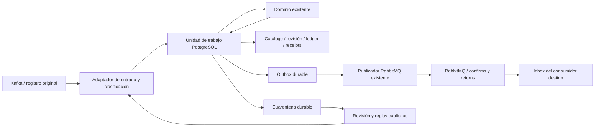

# FASE 7G — Diseño de fiabilidad y preparación de implementación

Fecha: 2026-11-14, America/Bogota. Base inspeccionada: HEAD `43aab3e`.
Estado: propuesta para aprobación; ninguna funcionalidad de este documento está
implementada por esta fase. Único archivo añadido: este documento.

## 1. Alcance, evidencia y decisiones recomendadas

Resolver conjuntamente recuperación del marcador, registros que bloquean Kafka,
contratos e idempotencia, preservando Java 17, Boot 3.5.7 y la arquitectura
hexagonal. No se modificaron fuentes, contratos, POM, Compose ni recursos.
No se publicaron eventos, ejecutaron resets o repitieron las pruebas 7E/7F.

Se revisaron [histórico 7B–7E](phase-7b-integration-report.md),
[auditoría 7F](phase-7f-robustness-report.md), sus fuentes de harness, logs, payloads
y reportes Surefire. Se recalcularon los 33 hashes de evidence/phase-7f/sha256.json:
todos coinciden. La suma de los XML archivados confirma 43 + 73 pruebas, sin
fallos/errores/omisiones. Esto verifica la evidencia histórica; no representa una
nueva ejecución Maven en 7G. Las 33 aserciones adicionales incluyen reproducción
de defectos, no 33 garantías funcionales satisfechas.

Recomendaciones, todavía sujetas a aprobación:

1. PostgreSQL como almacén del catálogo, eventos aceptados, revisión, outbox y
   cuarentena del servicio. Ya figura en README; NO hay adaptador JDBC, driver,
   instancia ni permisos comprobados para este servicio. Añadirlos requiere aprobación.
2. Recuperar desde el historial aceptado durable, sin volver a publicar al
   reconstruir; snapshots completos se difieren hasta necesitar optimización.
3. Conservar inicialmente publicación síncrona y ack Kafka posterior a RabbitMQ
   para eventos aplicados. Añadir drenaje de pendientes al arrancar, aunque no
   llegue un nuevo evento. No introducir un dispatcher distribuido en el primer cambio.
4. Confirmar registros inválidos o diferidos solo tras guardarlos en cuarentena
   durable. Una anulación adelantada conserva su ID y se reevalúa mediante replay
   explícito; no se trata como JSON roto ni se descarta silenciosamente.
5. Entrega al menos una vez con deduplicación durable en ambos extremos. No
   prometer una transacción atómica entre PostgreSQL, Kafka y RabbitMQ.

## 2. Causas raíz y puntos de extensión reales

Las referencias relativas son a archivos existentes; los números corresponden
al checkout inspeccionado.

| Hallazgo | Causa exacta y referencia |
|---|---|
| Estado vuelve a cero | [MessagingConfiguration.java](../services/match-state-service/src/main/java/com/live_jgv/matchstate/infrastructure/config/MessagingConfiguration.java), líneas 62–68: crea store con MatchState.start en cada arranque |
| Historial/outbox desaparecen | [InMemoryMatchStateStore.java](../services/match-state-service/src/main/java/com/live_jgv/matchstate/infrastructure/memory/InMemoryMatchStateStore.java), líneas 13–16, 18–23: mapas del proceso sin carga durable |
| Offsets no reconstruyen el estado | [application.properties](../services/match-state-service/src/main/resources/application.properties), líneas 6–10: earliest es política para ausencia de offset válido, no replay de offsets confirmados; evidencia real 7F tras reinicio |
| CAS no portable a base de datos | InMemoryMatchStateStore, líneas 33–46: compara identidad Java; [MatchStateRepository.java](../services/match-state-service/src/main/java/com/live_jgv/matchstate/domain/port/MatchStateRepository.java), líneas 11–17, ya exige revisión explícita para adapter futuro |
| Malformado falla dentro del listener | [KafkaMatchEventListener.java](../services/match-state-service/src/main/java/com/live_jgv/matchstate/entrypoint/kafka/KafkaMatchEventListener.java), líneas 24–34: readValue/toDomain y comprobación de clave, envueltos en InvalidKafkaMessageException |
| Anulación adelantada falla en dominio | [MatchState.java](../services/match-state-service/src/main/java/com/live_jgv/matchstate/domain/model/MatchState.java), líneas 65–70 y 80–86: referencia debe ser GOAL activo ya aceptado |
| Ambos bloquean la partición | MessagingConfiguration, líneas 84–92: todas las excepciones reintentables, UNLIMITED_ATTEMPTS y recuperador que siempre lanza; no hay persistencia del rechazo ni salida de cuarentena |
| Deduplicación solo en memoria | MatchState, líneas 45–50: ID igual + record igual retorna el mismo objeto; misma identidad con contenido distinto falla |
| Confirmación incierta puede duplicar | [RabbitScoreUpdatePublisher.java](../services/match-state-service/src/main/java/com/live_jgv/matchstate/infrastructure/rabbit/RabbitScoreUpdatePublisher.java), líneas 51–59: message_id estable, espera confirm/return; [ProcessAndPublishMatchEvent.java](../services/match-state-service/src/main/java/com/live_jgv/matchstate/application/service/ProcessAndPublishMatchEvent.java), líneas 33–36: envío y markPublished son operaciones separadas |
| Pendiente depende de nueva entrada | ProcessAndPublishMatchEvent, líneas 25–29: flush solo se invoca al procesar un evento de ese partido |
| JSON y clave reales | [KafkaMatchEventPublisher.java](../services/live-feed-producer/src/main/java/com/live_jgv/live_feed_producer/infrastructure/kafka/KafkaMatchEventPublisher.java), líneas 25–29, 41 y 47: snake_case, ISO textual y clave event.matchId() |

El dominio calcula el marcador a partir de goles aceptados no anulados, no mediante
un decremento arbitrario. Conservar solo home_score/away_score perdería la
información necesaria para validar referencias y deduplicar anulaciones.

La prueba `newStoreDoesNotRecoverStateOrOutboxAfterRestart` documenta el límite;
7F lo reprodujo con Kafka/RabbitMQ reales. La prueba
`rejectsMissingGoalWithoutConsumingEventAndAllowsRetryAfterGoal` muestra que el
dominio permite reintentar una anulación después de aceptar su gol, pero el
listener actual no puede alcanzar ese gol si está detrás en la misma partición.

## 3. Alternativas y elección

| Alternativa | Ventajas | Coste y limitaciones | Decisión |
|---|---|---|---|
| PostgreSQL: catálogo + historial + outbox + cuarentena | Un único commit durable para efecto, identidad y entrega pendiente; compatible con puertos actuales | Dependencia JDBC, migraciones y operación de BD; disponibilidad/backup necesarios | Recomendada, sujeta a aprobación |
| Reconstruir todo desde Kafka al arrancar | Usa infraestructura de eventos ya presente | Requiere historial íntegro, catálogo y reglas originales; offsets compartidos no deben resetearse; riesgo de republicar snapshots viejos; no resuelve por sí sola pendientes confirmados de forma incierta | Solo recuperación extraordinaria en grupo/almacén separados |
| Snapshot durable + replay de cola del historial | Reduce coste de arranque cuando crece el historial | Debe incluir revisión, dedup, referencias y frontera consistente; más formatos y migraciones | Optimización posterior sobre el ledger de PostgreSQL |
| Guardar únicamente marcador en archivo local | Pocos cambios aparentes | No asegura atomicidad con IDs/outbox; host/volumen único y corrupción/rebalance | Descartada para la garantía requerida |
| Kafka Streams/state store | Recuperación y particionado especializados | Cambia arquitectura y librerías; no vuelve atómica la salida RabbitMQ | No justificada para el alcance actual |
| Reintentos infinitos para todo | Conserva registros sin saltarlos | Reproduce el bloqueo 7F; una referencia futura no aparece al repetir el mismo offset | Descartada para errores permanentes/dependencias adelantadas |
| DLT Kafka como cuarentena primaria | Visible con herramientas Kafka | Publicación + offset también tienen ventana; requiere topic y consumidores nuevos | Alternativa válida, no necesaria si ya se aprueba PostgreSQL |
| XA/transacción distribuida entre tres sistemas | Pretende atomicidad global | Complejidad y soporte heterogéneo; innecesaria con outbox/inbox idempotentes | Descartada |

No añadir Redis, otro broker ni un schema registry en este primer alcance.
PostgreSQL es una dependencia prevista en el proyecto, pero no se supone que la
instancia de DEV 3 esté disponible ni que su base histórica sea propiedad de DEV 1.
Proponer esquema/credencial propios de match-state-service; sin escritura directa
en tablas de otros microservicios.

## 4. Arquitectura propuesta e invariantes



Invariantes a probar antes de habilitar el perfil durable:

- Un evento aplicado tiene exactamente un asiento del ledger y una salida outbox.
- No se confirma un registro Kafka hasta transferir durablemente su responsabilidad:
  aplicado con salida confirmada, duplicado ya aplicado, o cuarentena/deferencia
  persistida. Confirmar una cuarentena no significa aplicarla al marcador.
- Una transacción fallida no deja marcador sin historial ni historial sin outbox.
- Un ID aplicado no vuelve a modificar estado. Un ID diferente que intenta anular
  otra vez el mismo gol es rechazo semántico, no duplicado benigno.
- Un reintento de publicación conserva ID, revisión, timestamp de actualización y
  payload guardados. No reconstruye una salida con la hora actual.
- Un error de BD, código desconocido o publicación no se convierte en descarte.
- No se ejecuta I/O RabbitMQ dentro de una transacción que bloquee filas del partido.
- No hay fallback silencioso a memoria si falla la BD.

Primer despliegue durable: un único consumidor/dispatcher por servicio, como el
alcance actual. La BD admite CAS entre escritores, pero eso por sí solo NO garantiza
orden de publicación entre múltiples instancias. Escalar requiere un diseño posterior
de propietario/lease con fencing por partido y pruebas de rebalance.

## 5. Persistencia, atomicidad y recuperación

### 5.1 Modelo lógico mínimo (propuesta, no DDL ejecutado)

| Relación | Identidad y datos esenciales | Restricciones |
|---|---|---|
| match_catalog | match_id; home_team_id; away_team_id; revisión actual; versión de reglas | PK match_id; equipos distintos/no vacíos; revisión >= 0 |
| accepted_event | match_id, event_id; campos normalizados; application_seq; hash; source_receipt_id; accepted_at | PK (match_id,event_id); UNIQUE (match_id,application_seq); FK catálogo |
| input_receipt | consumer_identity, source_cluster_id, topic_epoch, topic, partition, offset; raw key/value; headers permitidos; hash; estado; event_id/match_id si decodificables | UNIQUE coordenadas + identidad lógica de consumidor; estado durable de cada ocurrencia |
| event_identity | match_id,event_id; contenido canónico/hash; estado APPLIED/DEFERRED/REJECTED; recibo propietario | PK (match_id,event_id); reserva identidad de eventos bien formados, incluso diferidos |
| score_outbox | match_id,event_id; application_seq; versión; payload serializado; message_id; destino; estado/attempts/next_attempt_at/published_at | UNIQUE (match_id,event_id,destino); FK accepted_event; payload inmutable |
| quarantine_case | receipt_id; reason_code; clasificación; first/last_seen; review_status; referencia esperada; resolución/replay_id | UNIQUE receipt_id; original inmutable |
| replay_attempt | replay_id; case_id; actor/motivo; fecha; resultado; recibo original; evento corregido si aplica | Identidad de solicitud única; auditoría append-only |

Estas son responsabilidades lógicas; input_receipt y quarantine_case pueden
co-localizarse en una tabla inicial si eso reduce código sin perder restricciones.
event_identity evita que un evento diferido y otro posterior con el mismo ID pero
distinto contenido compitan. accepted_event contiene solo eventos realmente aplicados.

source_cluster_id y topic_epoch evitan confundir un offset reutilizado tras recrear
un topic. Deben provenir del entorno registrado/identidad del topic, no de una
suposición de unicidad mundial de (topic,partition,offset). Cambiar grupo para
replay no crea una nueva identidad de evento de negocio.

El marcador puede calcularse al cargar desde el ledger, sin almacenar un snapshot
completo inicialmente. El orden durable es application_seq, NO event_id, hash-map,
minute o timestamp. La revisión es ese contador de aplicaciones aceptadas y no
avanza por duplicados ni por registros que solo entren en cuarentena.

### 5.2 Carga del agregado y cambios mínimos a los puertos

La primera versión crea MatchState.start con catálogo durable y aplica
accepted_event ordenado por application_seq para rehidratar el agregado. No genera
outbox durante esa carga, ni invoca ProcessAndPublishMatchEvent. Verifica que el
último application_seq coincide con la revisión del catálogo; una discrepancia
detiene el arranque del partido, no lo inicializa a cero.

Se conserva el dominio sin dependencias JDBC/Jackson/Spring. No se serializa el
objeto Java completo ni se usa reflection para invocar su constructor privado.
Esto evita una nueva fábrica de restauración hasta necesitar snapshots reales.
El coste inicial es proporcional al historial del partido; aceptable para el
simulador actual, sujeto a medición y retención explícita.

Propuesta de contrato del repositorio futuro: devolver un valor inmutable
`LoadedMatch(state, revision)` y hacer CAS contra revision, no identidad del
objeto. Adaptar MatchStateService para usar ese valor es un cambio pequeño pero
necesario: implementar JDBC sin revisar el CAS actual sería incorrecto.

La unidad de trabajo usa una fachada transaccional en infraestructura (por ejemplo,
TransactionTemplate) que ejecuta lectura, dominio y persistencia con la misma
conexión. Las capas interiores continúan sin anotaciones Spring. El caso de uso
produce un resultado de aceptación; la publicación queda fuera de esa transacción.
El adaptador de entrada conserva coordenadas en un envelope separado del MatchEvent
de negocio, sin introducir ConsumerRecord en el dominio.

### 5.3 Transacciones y offsets

Para una entrada válida nueva:

1. Abrir transacción local. Reservar recibo e identidad; si ya existen, verificar
   contenido y estado, nunca suponer que toda identidad reservada está aplicada.
2. Cargar catálogo y revisión, rehidratar agregado, aplicar evento.
3. Ejecutar CAS `revision=expected` → `expected+1`; insertar ledger, resultado
   del recibo y salida outbox serializada en el mismo commit. Cualquier fallo
   revierte todo. Orden de locks fijo por match_id; reintentar la unidad completa
   ante conflicto, con lectura nueva.
4. Cerrar transacción. Publicar salidas pendientes del partido en application_seq,
   esperando confirm positivo y ausencia de return.
5. En otra transacción, marcar salida confirmada. Solo entonces retornar al
   listener para el commit Kafka de ese registro. Duplicados sin pendientes
   retornan sin publicar otra vez.

Una entrada inválida/deferida sigue otro camino: transacción de receipt,
quarantine_case y reserva de identidad si procede; no modifica ledger/marcador ni
crea ScoreUpdate. Solo después del commit retorna con resultado QUARANTINED o
DEFERRED y el contenedor puede confirmar Kafka.

La carga de catálogo/revisión e historial debe usar la misma vista consistente:
una única consulta SQL que una catálogo y ledger, o una transacción de lectura
Repeatable Read con reintento completo ante conflicto. No cargar revisión y
ledger en dos consultas Read Committed independientes y confundir una escritura
concurrente con corrupción. El adapter debe especificar y probar esa frontera.
Read Committed con esa consulta consistente + CAS y constraints es suficiente
para esta primera versión;
SELECT FOR UPDATE es alternativa para serializar por partido, pero no se combinan
dos estrategias de concurrencia sin necesidad. Las violaciones de unicidad y
conflictos deben resolverse con rollback y lectura de la identidad existente.
No mantener un lock SQL mientras se espera un broker. PostgreSQL documenta que
los locks de fila se conservan hasta terminar la transacción; esto respalda la
separación de red y unidad de trabajo, no una garantía distribuida.
([Locks de PostgreSQL](https://www.postgresql.org/docs/current/explicit-locking.html)).

### 5.4 Arranque, recuperación y migración desde memoria

- BD y versión de esquema obligatorias antes de iniciar listener. Si no existen,
  readiness negativa y diagnóstico; no pasar a modo memoria automáticamente.
- Sembrar solo partidos nuevos mediante configuración. Para partido existente,
  comparar equipos; una configuración incompatible falla, nunca sobrescribe estado.
- Recuperar pendientes globales al arrancar, en orden por partido, aunque no llegue
  otra entrada. Primera versión: gate de arranque, drenaje serial y reintento con
  backoff; listener arranca tras completar el drenaje. Si RabbitMQ falla, mantener
  readiness negativa y outbox íntegra. Se acepta este bloqueo global inicial
  a cambio de simplicidad; aislarlo por partido se difiere.
- Con offsets confirmados y BD intacta, cargar ledger. earliest no interviene.
- Si el commit de BD ocurrió y el offset Kafka no, la reentrega consulta identidad
  y reenvía solo la salida pendiente si la hay.
- Un restore de BD anterior a offsets Kafka NO es recuperación automática segura:
  detener consumo y reconciliar con el historial disponible en un grupo/almacén de
  reconstrucción aparte. No arrancar con snapshot atrasado y offsets recientes.
- Para habilitar persistencia en partidos ya consumidos en memoria, hacer corte
  controlado y reconstrucción del historial completo en entorno/salida aislados;
  comparar marcador/referencias antes del cambio. Si falta historia, declarar
  imposible reconstruir automáticamente; no inventar un historial a partir de 0–1.
- No resetear offsets 7E ni eliminar recursos históricos. Plan de rollback del
  despliegue: detener nueva versión y restaurar binario compatible con el esquema,
  sin volver a memoria sobre offsets ya confirmados.

Snapshots futuros incluirían catálogo, revisión, formato/versión de reglas,
historial o índice de dedup y goles anulados, además de la frontera del ledger.
Snapshot y frontera se guardan juntos; replay solo de application_seq superior,
sin publicar de nuevo efectos históricos. Backup/restore probado es requisito
operativo; una BD durable sin volumen persistente/backup no satisface el objetivo.

## 6. Clasificación, reintentos, cuarentena y replay

### 6.1 Clasificar por razón tipada, no por texto de excepción

| Clase | Ejemplos | Acción propuesta |
|---|---|---|
| MALFORMED | JSON roto, campos desconocidos, tipo incorrecto, timestamp ilegible, tombstone, clave distinta a match_id | Cuarentena inmediata durable; sin reintentos idénticos |
| PERMANENT_DOMAIN | Equipo ajeno, referencia a no-GOAL conocido, otra anulación distinta sobre gol ya anulado, ID con contenido distinto | Cuarentena con razón; no mutar estado |
| WAITING_REFERENCE | GOAL_ANNULLED válido estructuralmente, referencia aún no aceptada | DEFERRED durable; avanzar registro para alcanzar el gol posterior |
| CONFIGURATION | Partido no registrado, esquema/credenciales/permiso incorrectos | Capturar recibo si BD permite, alertar; partido no registrado se aparca pendiente de catálogo; permisos de BD/Kafka no se resuelven descartando registros |
| TRANSIENT_STORAGE | Conexión BD, deadlock, conflicto CAS | Reintento acotado de la unidad completa; agotado: pausa con salud/alerta, sin confirmar |
| TRANSIENT_PUBLICATION | Rabbit connection/nack/timeout/return | Mantener outbox; reintento y posterior pausa; nunca cuarentenar el evento ya aplicado como inválido |
| UNKNOWN_BUG | NullPointerException inesperado, inconsistencia de restauración | Fallar de forma visible y pausar; no capturar como inválido genérico |

InvalidMatchEventException y IllegalArgumentException actuales no distinguen todas
esas razones. Se necesitarán reason codes/excepciones tipadas o un resultado de
validación, con tests. No clasificar todo IllegalArgumentException como permanente:
actualmente también representa partido no registrado y errores de configuración.
VAR_CHECK con referencia ausente se aparca para revisión igual que dependencia
faltante, sin promoverlo automáticamente; un VAR_CHECK sin referencia sigue siendo
revisión general válida.

Política inicial propuesta, ajustable y pendiente de aprobación: intento inicial
+ tres reintentos transitorios con esperas 1, 2 y 4 s. Tras agotar, pausar el
contenedor propio con alarma y comprobación de salud cada 30 s; reanudar mediante
la API del contenedor en un hilo seguro, sin commits/seeks manuales desde el hilo
de health. No confundir reintentos limitados con permiso para perder el registro.
Las pausas largas deben mantener el ciclo poll/heartbeat de forma soportada por
Spring; la prueba de max.poll.interval y rebalances es obligatoria.

Con AckMode.RECORD, preferir que el camino de cuarentena durable retorne
normalmente desde el adaptador después del commit. Evita un recuperador genérico
que solo escriba un log y omita datos. El error handler queda para transitorios y
fallos no clasificados. No basta con activar commitRecovered=true: su semántica
depende del modo de ack. Debe probarse contra Spring Kafka 3.3.10 resuelto en 7F,
no copiar configuración de documentación 4.x.
([Manejo de errores Spring Kafka 3.3](https://docs.spring.io/spring-kafka/reference/3.3/kafka/annotation-error-handling.html)).

### 6.2 Cuarentena durable como fuente de trazabilidad

Guardar original y coordenadas antes del ack, incluso cuando no haya event_id:
raw key/value (incluido null y bytes originales), topic/partición/offset, origen,
headers permitidos, razón estable, timestamps de recepción/intentos, versión de
lector y vínculo de resolución. No imprimir cuerpos/credenciales en logs.

El transporte actual StringDeserializer pierde la representación exacta de bytes
UTF-8 inválidos. Si se exige conservar originales byte a byte, el adaptador futuro
deberá leer byte[] y decodificar UTF-8 estrictamente antes de Jackson; esto cambia
configuración/pruebas de transporte, no el JSON del contrato. Si se conserva
StringDeserializer como primer incremento, registrar explícitamente la limitación
y no anunciar preservación forense completa.

Cuotas y retención son decisiones de operación, no borrado automático silencioso:
si se alcanza capacidad, detener ack y alertar. Propuesta inicial de retención:
conservar sin purga durante la primera integración; aprobar un horizonte al menos
igual al máximo replay operativo antes de implementar limpieza.

Una DLT opcional `match_events.dlt` puede ser espejo de quarantine_case mediante
outbox de auditoría, con case_id estable y consumidor deduplicador. No depender
de que DLT y PostgreSQL confirmen simultáneamente. Si se elige DLT como almacén
primario alternativo, no confirmar origen hasta verificar el envío; si ese envío
falla, retener offset. No son dos cuarentenas autoritativas independientes.

### 6.3 Anulación adelantada y orden de aplicación

No resolver una referencia ausente repitiendo indefinidamente su offset. Reservar
la identidad como DEFERRED, registrar la dependencia y permitir que el GOAL
posterior alcance el dominio. La reserva NO entra en processedEvents/accepted_event.

Primera versión recomendada: replay revisado, no aplicación automática:

1. Al aceptar el gol, localizar casos referidos y marcarlos READY_FOR_REVIEW de
   forma durable (o mediante consulta al revisar). No crear ScoreUpdate por ello.
2. El responsable revisa partido, tipo del gol, equipo, si fue anulado y estado
   VAR actual. Autoriza replay con replay_id, motivo y revisión esperada del partido.
3. El caso de uso de replay lee el evento diferido original y lo revalida contra
   el estado ACTUAL, CAS mediante revisión; si hubo cambio concurrente, vuelve a
   revisión. No modifica timestamps/ID para simular un evento nuevo.
4. Si se acepta, usa la misma transacción de dominio/ledger/outbox, crea nueva
   application_seq y pasa DEFERRED → APPLIED. La salida conserva event_id y
   reference_event_id; updated_at es la fecha de aplicación efectiva.
5. Marca resolución enlazada al evento aplicado; si falla publicación, sigue
   pendiente de outbox, no vuelve a aplicar. Otra solicitud de replay del mismo
   evento aplicado retorna su resultado sin otra salida.

Reaplicar tarde puede cerrar una revisión VAR posterior: no se promete reordenar
por timestamp ni reconstruir automáticamente la historia deportiva. El replay
asume explícitamente semántica de orden de aplicación. Si el equipo necesita
orden histórico estricto, deberá aprobar buffering/reconstrucción y eventos de
corrección versionados como alcance posterior. Esa es la razón para no introducir
un reintento automático de referencias como parche mínimo.

Una dependencia que no aparece sigue DEFERRED y genera alerta por antigüedad;
propuesta: alerta tras 5 min, revisión de SLA a 24 h. No borrar, aplicar ni cambiar
automáticamente a APPLIED por timeout. No se garantiza recuperación automática
de una anulación adelantada en la primera implementación.

Para JSON corregido: preservar original y crear evento nuevo con ID nuevo y
vínculo de auditoría fuera del payload v1; un payload cambiado no debe reutilizar
un ID reservado. No reenviar bytes permanentemente malformados en bucle al topic.
El mecanismo operativo futuro puede ser un comando administrativo local, sin
añadir endpoints REST; requerirá aprobación/implementación. No existe hoy.

## 7. Contratos propuestos y compatibilidad

### 7.1 Línea base v1.0 (propuesta, no contratos vigentes)

Usar documentos JSON Schema Draft 2020-12 versionados e inmutables, con IDs lógicos
`urn:live-jvg:match-event:1.0` y `urn:live-jvg:score-update:1.0`. Los schemas locales
existentes son la base; NO se han promovido a contracts/events. Rutas futuras
posibles: contracts/events/v1/match-event.schema.json y score-update.schema.json.
No se requieren un registro externo ni cambios de topic para formalizar el formato
actual, pero sí revisión y autorización de DEV 2/DEV 3.

Transportes: Kafka match_events, clave String exactamente igual a match_id;
RabbitMQ live_updates tipo topic, routing score.{match_id}, JSON UTF-8 persistente,
message_id=event_id. Recomendar IDs de partido sin '.' ni '*' ni '#' para evitar
ambigüedad de routing; imponerlo a IDs existentes sería una restricción nueva que
necesita inventario/migración. No declararla ya aplicada por el código.

| MatchEvent v1.0 | Tipo / obligación | Semántica |
|---|---|---|
| event_id | String no blanco, obligatorio | Identidad estable; no exige UUID a lectores aunque create lo genera |
| match_id | String no blanco, obligatorio | Partido ya registrado; igualdad exacta/sensible a mayúsculas |
| event_type | Enum obligatorio | GOAL, VAR_CHECK, GOAL_ANNULLED, MATCH_CONTINUES |
| team_id | String o null; opcional salvo GOAL | GOAL exige identificador no blanco; cualquier valor no nulo debe corresponder al partido |
| minute | Integer obligatorio, 0..130 | Límite actual del simulador; no regla universal del fútbol |
| timestamp | String obligatorio, date-time | Instant textual; no determina el orden de aplicación |
| reference_event_id | String o null; opcional salvo GOAL_ANNULLED | Anulación exige ID no blanco de GOAL original; VAR_CHECK referido exige gol activo; MATCH_CONTINUES lo conserva como metadato |

| ScoreUpdate v1.0 | Tipo / obligación | Semántica |
|---|---|---|
| match_id | String no blanco, obligatorio | Partido de entrada |
| home_score / away_score | Integer >=0, obligatorios | Snapshot resultante, no delta |
| event_id | String no blanco, obligatorio | ID de la entrada aplicada, sin generar otro por reintento |
| event_type | Mismo enum, obligatorio | Tipo que causó actualización |
| updated_at | String date-time, obligatorio | Fecha de aplicación; persistida e inmutable para esa salida |
| var_status | CLEAR o IN_PROGRESS, obligatorio | Estado resultante |
| reference_event_id | String o null; obligatorio/no blanco si anulación | Referencia original; en otras salidas puede omitirse o ser null |

Ambos schemas v1 cierran additionalProperties=false. Campos opcionales ausentes
y null se normalizan de igual modo. La salida actual del publicador incluye nulls.
Activar format assertion y verificar compatibilidad con Instant.parse: JSON Schema
date-time por sí solo no prueba que la cadena sea aceptada por Java. El perfil
publicable debe ser la intersección validada de RFC 3339 y las fechas serializadas
por el productor; probar offsets, fracciones, límites y rechazos, sin aceptar
fechas ampliadas solo porque Instant las soporte. No limitar a tres decimales:
7E/7F contienen seis y deben seguir siendo válidas.

Reglas cruzadas de schema propuestas: required condicional de team_id en GOAL y
reference_event_id en GOAL_ANNULLED, patrón no blanco para esos identificadores,
min/max de minute y marcadores, enum textual, rechazo de campos extra. Existencia,
pertenencia, duplicados, actividad del gol y semántica de replay son validaciones
del dominio/almacén, no del schema.

Para la línea base, mantener opcionales genéricos con tipo string/null como en
las propuestas actuales; no afirmar que string vacío sea semánticamente válido.
Endurecerlos globalmente a no blancos es compatible con el dominio de consumo
pero no con todo objeto construible por el productor; se ensaya antes de promover
la restricción. La discrepancia debe figurar en la revisión contractual.

### 7.2 Versionado sin romper al lector estricto

NO añadir schema_version al cuerpo v1: el listener rechaza campos desconocidos.
Versionar los artefactos y, tras acuerdo, usar header schema_name/schema_version;
para mensajes históricos sin header, aceptar v1 por una política explícita.
Hasta implementar lector de headers, son metadatos propuestos, no control de versión
ya existente. Una versión desconocida explícita debe aparcarse, no tratarse como v1.

Con lectores estrictos, añadir campos o valores enum no es automáticamente
retrocompatible. Patch documental sin cambiar el conjunto de mensajes aceptados;
todo cambio de forma/semántica requiere probar matriz productor viejo/nuevo y
consumidor viejo/nuevo. No relajar FAIL_ON_UNKNOWN_PROPERTIES globalmente para
eludir una migración.

### 7.3 ScoreUpdate v2 para snapshots fuera de orden

La deduplicación por ID evita repetir el mismo efecto, pero no impide que un
snapshot de otro ID más antiguo sobrescriba uno nuevo. Propuesta v2, posterior
a persistencia y aprobada con consumidores:

- Mantener campos v1 y añadir `schema_version` constante `2.0` y
  `state_revision` integer >=1, obligatorio y monotónico por partido.
- Conservar event_id original. La revisión la asigna CAS al aceptar el evento;
  se persiste en outbox y nunca se recalcula durante reenvío.
- Consumidor guarda last_revision junto con su efecto/inbox: acepta mayor,
  ignora menor como snapshot obsoleto, y detecta misma revisión con contenido
  distinto como conflicto. Un salto de revisión puede aceptarse para snapshots
  completos y alertarse; quienes requieren todos los eventos no pueden usar
  esa regla para omitir efectos laterales.
- Publicar inicialmente en exchange nuevo `live_updates.v2` con routing
  score.{match_id}; consumidores antiguos permanecen en v1. No enviar v2 al
  exchange de lectores v1 estrictos. En dual-publish, una fila outbox por destino;
  dedup destino evita aplicar dos veces el mismo hecho al migrar.
- No habilitar v2 sin consumidores preparados ni retirar v1 sin corte acordado.
  No hace falta cambiar Kafka MatchEvent v1 para este enriquecimiento de salida.

Ejemplo ilustrativo v2, NO mensaje observado ni publicado:

```json
{
  "schema_version": "2.0",
  "match_id": "design-match",
  "state_revision": 3,
  "home_score": 0,
  "away_score": 0,
  "event_id": "design-annulment",
  "event_type": "GOAL_ANNULLED",
  "updated_at": "2026-11-14T21:00:00Z",
  "var_status": "CLEAR",
  "reference_event_id": "design-goal"
}
```

Cambios que exigen migración: introducir campos en v1, nuevos enums, cambiar tipo
de minute o timestamps, imponer UUID, retirar nulls/omisiones, cambiar clave/topic,
normalizar IDs, ampliar/reducir límites con lectores antiguos o redefinir
reference_event_id como revisión en lugar de gol. Aprobación de schemas no implica
que estas migraciones estén autorizadas.

## 8. Idempotencia durable y ventanas de fallo

Identidad de negocio inicial: (match_id,event_id), coherente con el dominio.
Unicidad global de event_id no está garantizada por el consumidor actual; imponerla
sería una decisión contractual nueva. message_id sigue event_id, pero downstream
debe deduplicar con match_id también.

Comparar los siete campos normalizados: opcionales ausentes → null; timestamp
→ Instant con precisión preservada; números sin coerción. Guardar representación
canónica versionada y SHA-256 para búsqueda/verificación, pero comparar también
contenido canónico antes de aceptar igualdad. Un hash no reemplaza validaciones
ni elimina la necesidad de resolver conflictos. No basarse en el orden de las
propiedades JSON, pretty-print o bytes de timestamp equivalentes.

| Caída / incertidumbre | Estado durable esperado | Recuperación |
|---|---|---|
| Antes del commit de aceptación | Sin ledger/outbox parcial | Reentrega Kafka vuelve a intentar |
| Commit BD exitoso, respuesta BD perdida | Resultado incierto para cliente, identidad única en BD | Consultar identidad al reintentar, nunca aplicar a ciegas |
| Commit BD, antes de enviar Rabbit | Outbox PENDING, evento APPLIED | Arranque drena outbox sin reaplicar |
| Rabbit recibe, confirm se pierde | Outbox continúa PENDING | Reenviar payload/ID/revisión idénticos; inbox destino elimina doble efecto |
| Confirm recibido, antes de marcar publicado | Rabbit puede contener mensaje, BD aún PENDING | Mismo reenvío seguro para consumidor idempotente |
| Publicado marcado, antes de commit Kafka | Identidad APPLIED y outbox PUBLISHED | Reentrega no aplica ni publica de nuevo |
| Cuarentena persistida, antes de commit Kafka | Recibo/caso ya existen | Upsert idempotente, sin multiplicar casos |
| Caída durante replay autorizado | DEFERRED o APPLIED atómicamente con outbox | Retomar por replay_id y estado durable, sin cambiar ID |
| Efecto downstream guardado, antes de ack AMQP | Inbox y efecto comprometidos en misma transacción | Reentrega se reconoce y se confirma sin repetir efecto |

La deduplicación del consumidor RabbitMQ debe ser transaccional con su propio
efecto; si llama servicios externos, necesita una estrategia idempotente para
ese efecto también. Un publisher confirm no confirma consumo final. RabbitMQ
documenta que una confirmación perdida puede obligar a retransmitir y duplicar;
la garantía propuesta es al menos una vez con efectos idempotentes, no exactly-once.
([Guía de fiabilidad RabbitMQ](https://www.rabbitmq.com/docs/reliability)).

Retener ledger/identidades al menos durante toda la ventana de replay y la vida
operativa del partido. Purgar IDs antes de que sea imposible una reentrega hace
volver a contar goles. Primera versión: sin purga automática y con alarmas de
capacidad; definir archivo/retención antes de operación sostenida.

## 9. Plan de implementación por cambios pequeños

Todos los cambios de esta tabla son FUTUROS y requieren autorización. No se han
creado migraciones ni ramas de implementación.

| Cambio | Alcance mínimo / dependencia | Aceptación obligatoria |
|---|---|---|
| G1 — Decisiones y fixtures contractuales | Aprobar tablas v1, política de errores, propiedad BD, semántica replay y perfil de fechas | Fixtures 7E/7F válidos; ejemplos inválidos rechazados; compatibilidad viejo/nuevo documentada; no cambios de producción |
| G2 — Revisión explícita | LoadedMatch y CAS por revisión en puerto/servicio; adaptar memoria y tests | Dos escritores con misma revisión: solo uno acepta; el otro relee; duplicado exacto no avanza revisión |
| G3 — JDBC y migraciones | Aprobar starter JDBC, driver PostgreSQL y un solo mecanismo de migración, por ejemplo Flyway; esquema propio sin tablas ajenas | Migrar BD vacía y reiniciar sin pérdida; constraints catálogo/eventos; fallo a mitad de transacción deja cero efectos parciales |
| G4 — Ledger + outbox durable | Unidad de trabajo, rehidratación y perfil durable; todavía conservar ack tras Rabbit | Caer antes/después de cada commit; marcador y referencias intactos tras reinicio; 0–1 defectuoso de 7F pasa a 1–1 |
| G5 — Drenaje al arrancar | Recuperar pendientes sin nueva entrada; orden serial y payload inmutable | Reiniciar con outbox pendiente y cero nuevos registros: publicación termina; mismo ID/updated_at; Rabbit caído no borra pendiente |
| G6 — Receipts y cuarentena | Envelope de transporte, reason codes y ruta durable para malformados/permanentes | Inválido seguido de válido: conserva original, cuarentena única y válido aplicado; BD caída no confirma el inválido |
| G7 — Referencias diferidas/replay | Reserva DEFERRED, revisión y replay auditado sin endpoint HTTP | Anulación delante de GOAL permite llegar al GOAL; replay autorizado anula una sola vez; revisión cambiada fuerza nueva evaluación |
| G8 — Backoff/pausa y observabilidad | Transitorios y bugs, sin recuperador log-only | Fallo Rabbit/BD no produce descarte; pausa tras presupuesto; reconexión reanuda; ningún rebalance confirma un offset no transferido |
| G9 — Inbox downstream y salida v2 | Diseño aprobado por DEV 2/3; cambios ajenos en sus propios PR | Reentrega tras confirm perdido no duplica efecto; snapshot viejo no sobrescribe revisión nueva; dual-publish sin doble aplicación |
| G10 — Integración/CI y corte | Brokers/BD aislados, migración de partidos existentes y runbook | Suites completas + matriz de ventanas de caída + reconciliación de historial; rollback ensayado; evidencia 7E intacta |

G4 no debe anunciar recuperación completa hasta G5; G6 depende de persistencia
disponible, no se habilita antes como simple swallow de excepción. G7 no marca
un evento aplicado al reservarlo. G8 no manda a cuarentena eventos ya aplicados
solo porque falló su publicación. G9 es condición para prometer idempotencia
extremo a extremo y protección de snapshots fuera de orden, no para el primer
despliegue durable de DEV 1 con consumidores legacy y límites explícitos.

## 10. Pruebas de aceptación detalladas (diseñadas, NO ejecutadas en 7G)

| ID | Preparación / fallo | Resultado verificable |
|---|---|---|
| P01 | GOAL home, confirmar Kafka, reiniciar servicio durable, GOAL away | Sale 1–1; ledger conserva ambos; no republíca GOAL home confirmado |
| P02 | Reentregar GOAL y anulación, mismos campos/ID, antes y después de reiniciar | Una aplicación y una fila outbox por evento/destino; marcador no negativo |
| P03 | Mismo ID con equipo, minuto o referencia diferentes | Conflicto durable enlazado al original; ningún cambio de estado |
| P04 | Misma identidad en JSON con orden distinto, null omitido y timestamp equivalente | Duplicado lógico, no conflicto ni efecto extra |
| P05 | Caer tras insertar ledger antes de outbox, dentro de la transacción | Rollback completo; reentrega aplica una vez |
| P06 | Caer tras commit de aceptación, antes de Rabbit y sin nuevos eventos | Drenaje inicial publica pendiente y limpia su estado |
| P07 | Rabbit acepta, perder confirm, matar consumidor propio y reiniciar | Puede haber dos entregas; payload/ID/revisión idénticos, un efecto downstream |
| P08 | Marcar publicado y fallar commit Kafka | Reentrega confirma sin republicar; outbox PUBLISHED e inbox consistentes |
| P09 | JSON malformado / clave incorrecta / null / bytes UTF-8 inválidos | Caso único por ocurrencia; original preservado bajo política aprobada; siguiente válido progresa |
| P10 | BD no disponible al registrar cuarentena | No commit Kafka; tras reconectar, un caso y avance correcto |
| P11 | Anulación a GOAL posterior en la misma partición | DEFERRED único, GOAL aplicado; replay autorizado deja 0–0 con IDs originales |
| P12 | Replay repetido, caída durante replay y cambio concurrente de revisión | Una aplicación; sin generar ID nuevo; conflicto de revisión vuelve a evaluación |
| P13 | Referencia nunca llega, apunta a otro partido/no-GOAL o ya anulado | Alertas/revisión; sin aplicar ni purgar silenciosamente |
| P14 | Diferido con mismo ID distinto contenido reaparece | Reserva de identidad detecta conflicto antes de ledger |
| P15 | Rabbit nack/return/timeout, fallo BD y bug desconocido | Cada clase toma su política; ningún evento aplicado se descarta como inválido |
| P16 | Agotar retries, superar demora normal de poll y reanudar | Pausa saludable, sin salto de offsets ni pérdida de recibos; rebalances ensayados |
| P17 | Consumidor Rabbit procesa efecto y cae antes de ack | Inbox y efecto atómicos; reentrega no duplica |
| P18 | ScoreUpdate v2 de revisión 8 y luego 7; misma revisión con payload distinto | 7 no regresa estado; conflicto de 8 se alerta; no comparación por reloj |
| P19 | Catálogo existente con equipos distintos a configuración / ledger corrupto | Arranque falla visible; no resetea a cero |
| P20 | Restaurar BD antigua con offsets Kafka recientes | Runbook bloquea consumo y exige reconciliación; no anuncia recuperación automática |
| P21 | Crash en cuarentena/replay/DLT espejo y reentrega | Mismo case_id/replay_id, trazabilidad original, sin loops ni pérdida silenciosa |
| P22 | Matriz productor/consumidor v1, headers ausentes/desconocidos y lector v2 | v1 sigue compatible; versión desconocida aparcada; nunca v2 a lector estricto v1 |

Ejecutar en recursos nuevos, con fault injection por proceso/cliente y logs
capturados desde el inicio. Identificar cada fallo inyectado por fase, no por
esperas arbitrarias: latches o puntos de prueba explícitos tras aprobación.
Las pruebas de BD deben usar PostgreSQL real, no inferir atomicidad desde mocks.
Mantener los 116 tests actuales como regresión; añadir pruebas que verifiquen
invariantes y ventanas de caída, no simplemente getters de la nueva implementación.

## 11. Riesgos, dependencias y aprobación necesaria

| Decisión | Recomendación | Aprobación / responsable |
|---|---|---|
| Propiedad y operación de PostgreSQL | Esquema y credenciales exclusivos de match-state, volumen/backup/restauración verificados | Responsable del proyecto + DEV 3; no usar tablas ajenas |
| Dependencias/migración | JDBC + driver + una herramienta, mantener Java/Boot actuales | Responsable del proyecto; POM no autorizado aún |
| Transferencia de responsabilidad de un inválido | Ack tras cuarentena durable, manteniendo trazabilidad y alerta | Responsable funcional y DEV 1 |
| Anulación adelantada | Diferir y replay revisado con revisión esperada | Responsable funcional; aceptar orden de aplicación y posible corrección tardía |
| Presupuesto de retries y SLA | Inicial+3, 1/2/4 s; health 30 s; alerta dependencia 5 min; revisión 24 h | Operación/equipo; valores propuestos, no requisitos existentes |
| Contratos v1 y v2 | Aprobar baseline, fechas, IDs, retención y migración de snapshots | DEV 1/2/3; schemas continúan intactos |
| Idempotencia destino | Inbox durable con efecto y revisión, no solo bandera redelivered | DEV 2/3 en sus servicios; no se modifican desde DEV 1 |
| Corte de datos existentes | Reconstrucción controlada y verificada con salida aislada | Responsable + DEV 3; no resetear evidencia 7E |
| Escalado | Una instancia inicialmente; multiinstancia requiere propietario/fencing de publicación | Responsable técnico; no asumir que CAS basta |
| Retención y seguridad | Sin purga automática inicial; límites, ACL, payloads protegidos y backup | Operación y responsables de datos |

Riesgos residuales explícitos: dependencia de BD; bloqueo temporal por RabbitMQ al
conservar publicación síncrona; carga del historial creciente; retraso de resolución
de casos diferidos; snapshots v1 sin revisión; reentregas inevitables bajo incertidumbre.
No eliminarlos mediante cambios simultáneos de arquitectura. Medir primero e
introducir dispatcher asíncrono/snapshots solo si el alcance los justifica.

## 12. Verificación de coherencia y cierre de diseño

Se comprobó por inspección que las propuestas no se contradicen:

- Reconstrucción solo de eventos APPLIED: cuarentena y DEFERRED no cuentan goles.
- CAS, ledger y outbox comparten transacción; retries nunca regeneran la salida.
- Kafka puede avanzar sobre un inválido solo porque otra custodia durable asumió
  el registro, no porque se silenció la excepción.
- Una identidad DEFERRED se distingue de una APPLIED; replay puede progresar sin
  romper la deduplicación, pero cambios de contenido continúan siendo conflictos.
- Drenar al arrancar resuelve pendientes sin necesitar otro mensaje Kafka.
- Serialización/v1 se mantienen para el primer cambio durable; revisión de salida
  v2 y consumidores se despliegan mediante acuerdo separado, sin campos sorpresa.
- DLT es espejo opcional, no segunda fuente de verdad ni nueva condición de ack.
- Reinicio con BD vigente no usa reset de offsets; restore de BD atrasada se trata
  como recuperación extraordinaria, no como arranque normal.
- Persistencia local e idempotencia del publisher Kafka no se confunden con
  exactly-once global; inbox destino y control de revisiones siguen siendo necesarios.

Verificaciones realizadas en 7G: búsquedas/listado con rg, lectura de código con
líneas, revisión de informes y schemas, recálculo de hashes 7F y sumatoria Surefire.
Se consultaron fuentes oficiales de Spring Kafka 3.3, RabbitMQ y PostgreSQL citadas
en contexto; las páginas muestran versiones más recientes que el runtime 7F,
por lo que se usa su principio de diseño, no se asume una API nueva disponible.
No fue necesario ejecutar brokers ni repetir Maven para validar un documento.

La implementación requiere aprobación de las decisiones de la sección 11 y del
primer bloque G1–G5. El documento deja pruebas y puntos de cambio concretos; no
declara resueltos en producción los defectos de 7F. No se alteraron evidencias,
recursos, documentación histórica ni código. Sin commits, merges o pushes.

## Anexo — Schemas v1.0 propuestos, solo para revisión

Estos bloques son propuestas dentro del documento. No crean ni cambian archivos
en contracts/events. Se comprueba su sintaxis JSON, no se declara ejecutada una
validación Draft 2020-12. Los IDs/versiones agregan identidad a los artefactos,
no campos al payload. Las reglas semánticas adicionales de la sección 7 siguen
siendo obligatorias y no todas pueden expresarse con JSON Schema.

### MatchEvent v1.0

```json
{
  "$schema": "https://json-schema.org/draft/2020-12/schema",
  "$id": "urn:live-jvg:match-event:1.0",
  "title": "MatchEvent v1.0 — proposed",
  "type": "object",
  "additionalProperties": false,
  "required": ["event_id", "match_id", "event_type", "minute", "timestamp"],
  "properties": {
    "event_id": {"$ref": "#/$defs/identifier"},
    "match_id": {"$ref": "#/$defs/identifier"},
    "event_type": {"enum": ["GOAL", "VAR_CHECK", "GOAL_ANNULLED", "MATCH_CONTINUES"]},
    "team_id": {"type": ["string", "null"]},
    "minute": {"type": "integer", "minimum": 0, "maximum": 130},
    "timestamp": {"type": "string", "format": "date-time"},
    "reference_event_id": {"type": ["string", "null"]}
  },
  "$defs": {
    "identifier": {"type": "string", "minLength": 1, "pattern": "\\S"}
  },
  "allOf": [
    {
      "if": {"properties": {"event_type": {"const": "GOAL"}}},
      "then": {"required": ["team_id"], "properties": {"team_id": {"$ref": "#/$defs/identifier"}}}
    },
    {
      "if": {"properties": {"event_type": {"const": "GOAL_ANNULLED"}}},
      "then": {"required": ["reference_event_id"], "properties": {"reference_event_id": {"$ref": "#/$defs/identifier"}}}
    }
  ]
}
```

### ScoreUpdate v1.0

```json
{
  "$schema": "https://json-schema.org/draft/2020-12/schema",
  "$id": "urn:live-jvg:score-update:1.0",
  "title": "ScoreUpdate v1.0 — proposed",
  "type": "object",
  "additionalProperties": false,
  "required": ["match_id", "home_score", "away_score", "event_id", "event_type", "updated_at", "var_status"],
  "properties": {
    "match_id": {"$ref": "#/$defs/identifier"},
    "home_score": {"type": "integer", "minimum": 0},
    "away_score": {"type": "integer", "minimum": 0},
    "event_id": {"$ref": "#/$defs/identifier"},
    "event_type": {"enum": ["GOAL", "VAR_CHECK", "GOAL_ANNULLED", "MATCH_CONTINUES"]},
    "updated_at": {"type": "string", "format": "date-time"},
    "var_status": {"enum": ["CLEAR", "IN_PROGRESS"]},
    "reference_event_id": {"type": ["string", "null"]}
  },
  "$defs": {
    "identifier": {"type": "string", "minLength": 1, "pattern": "\\S"}
  },
  "allOf": [
    {
      "if": {"properties": {"event_type": {"const": "GOAL_ANNULLED"}}},
      "then": {"required": ["reference_event_id"], "properties": {"reference_event_id": {"$ref": "#/$defs/identifier"}}}
    }
  ]
}
```
