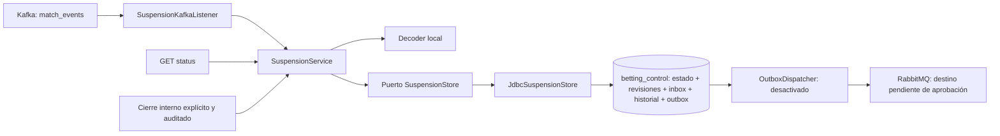

> Estado actual Fase 6: V1 + V2 requeridas, aún no aplicadas. La autoridad atómica y el emisor interno de leases están preparados e inactivos; no hay caller/verificador de catch-up aprobado. Ver phase-6-atomic-security.md.

# Betting Suspension Service — DEV 3, Fase 3

Implementación local Java 17 / Spring Boot 3.5.7. Política provisional conservadora para apuestas simuladas. Sin dinero real, worker, contratos compartidos nuevos, migraciones ejecutadas ni infraestructura iniciada.

## Alcance y arquitectura

Solo cambia `services/betting-suspension-service/`. Se consultaron en lectura el diseño DEV 3, los DTO/publicador del productor, la configuración del núcleo y Historical Archiver. Se reutilizan como referencia sus técnicas de captura de bytes y decoder, mediante clases locales: no se añade dependencia Java de otro microservicio ni se modifica el archiver.



Capas: `domain` contiene agregado inmutable y comandos internos; `application` contiene casos de uso y puertos; `infrastructure` implementa JDBC/transacciones, decoder, reintentos y outbox; `entrypoint` contiene Kafka, REST y errores HTTP.

Dependencias: Web, Validation, Actuator, JDBC, Spring Kafka, AMQP, PostgreSQL, Flyway core/PostgreSQL y Boot Test. Sin JPA, motor de DB emulado ni tecnologías adicionales. Ver `evidence/dependencies.txt` para versiones resueltas.

## Política de dominio y bloqueo contractual

`MarketState` mantiene `matchId`, `status`, `version`, `lastEventId`, `updatedAt`, inconsistencia y revisiones pendientes. `betsAllowed` solo es true para OPEN consistente sin revisiones pendientes. No hay apertura inicial automática.

| Entrada | Comportamiento |
|---|---|
| Sin información | UNKNOWN, bloqueado |
| GOAL | Registra hecho/versiona; nunca abre un mercado bloqueado |
| VAR_CHECK nuevo | SUSPENDED y revisión pendiente identificada por el event_id de ese VAR_CHECK |
| MATCH_CONTINUES de Kafka | Registra hecho/versiona; no cierra revisiones ni autoriza apertura |
| GOAL_ANNULLED | SUSPENDED; no cierra revisiones. Si no hay una revisión pendiente correlacionada con el gol referenciado, marca incertidumbre |
| Duplicado con igual identidad/contenido | Sin nueva versión, transición u outbox |
| Misma identidad con contenido diferente | Guarda conflicto; estado UNKNOWN/inconsistente, bloqueado |
| JSON/tipos/clave inválidos | Cuarentena durable; no se aplica transición de apertura |
| Cierre explícito válido | Cierra solo la revisión indicada; OPEN únicamente si no quedan revisiones y no existe inconsistencia |

La continuidad deportiva disponible no identifica inequívocamente una revisión cerrada: no exige referencia en MATCH_CONTINUES y VAR_CHECK puede llegar sin referencia. No se inventa un identificador de revisión en ese contrato. Por esto la integración que podría reabrir apuestas queda **sin adaptador de entrada**: el listener Kafka no llama al cierre explícito, independientemente de flags.

### Interfaz explícita de cierre, interna y no expuesta

`SuspensionService.closeReview(ReviewClosure)` / `SuspensionStore.closeReview(...)` exige:

- `commandId`, `matchId`, `reviewId` (event_id del VAR_CHECK), `continuationEventId`, `expectedVersion`, `actor` y `reason` no vacíos donde corresponda.
- Revisión realmente pendiente en el mismo partido, estado sin inconsistencia y versión esperada exacta.
- MATCH_CONTINUES existente en el ledger del mismo partido y con revisión de aplicación posterior a la apertura de esa revisión.
- Cierre de una sola revisión. Si quedan otras, continúa SUSPENDED. Una continuación puede justificar varios cierres solo mediante decisiones explícitas separadas, cada una auditada y con su versión esperada actual.

No es una extensión del DTO deportivo, endpoint administrativo, interpretación de `reference_event_id` ni contrato de comandos aprobado. La autoridad para afirmar la correlación debe aprobarse antes de conectar cualquier caller. El orden de aplicación y el control de versión son comprobaciones técnicas: no demuestran por sí solos causalidad deportiva ni sustituyen esa autoridad.

Comando repetido idéntico devuelve el estado actual sin ejecutar de nuevo, incluso si desde entonces llegaron otras revisiones. Mismo commandId/partido con otro contenido: rechazo y rollback. Un cierre con versión obsoleta, revisión desconocida, continuación previa al VAR o falta de evidencia no abre el mercado.

Un GOAL_ANNULLED tardío después de un cierre lo vuelve a bloquear y marca inconsistencia. No se supone que las anulaciones siempre anteceden a la continuación. Una inconsistencia no puede borrarse mediante el cierre normal de otra revisión; su reconciliación administrativa queda pendiente y no existe endpoint para forzar OPEN.

## Contrato deportivo provisional

Fuente confirmada por código: Kafka `match_events`; clave igual a `match_id`, JSON UTF-8 `snake_case`. Grupo propio `betting-suspension-service`, configurable y distinto del núcleo. Se preservan bytes, headers repetidos/null, posición de transporte y timestamps.

Campos observados: `event_id`, `match_id`, `event_type`, `team_id`, `minute`, `timestamp`, `reference_event_id`. Eventos admitidos: GOAL, VAR_CHECK, GOAL_ANNULLED y MATCH_CONTINUES. Los IDs son strings no vacíos, no se exige UUID. Minuto entero 0..130; Instant preserva precisión de timestamp; GOAL requiere equipo y GOAL_ANNULLED referencia no vacía. No se exige referencia de cierre inexistente al resto del tráfico.

El decoder rechaza coerciones de tipo, campos desconocidos, JSON incompleto/duplicado, tokens extra, UTF-8 incorrecto y clave divergente. Campos futuros se conservan como cuarentena para revisión, sin alegar compatibilidad futura automática. El esquema compartido sigue vacío y no se modificó.

Identidad de negocio: **(match_id,event_id)**, consistente con el almacenamiento de match-state-service y el diseño DEV 3. Un mismo ID en otro partido es otra identidad; unicidad global requiere decisión explícita. Comparación estructural canónica: ignora espacios/orden de claves y equipara opcionales ausentes/null; no equipara valores textuales de timestamp diferentes. La evidencia original no se reemplaza.

Los fixtures de cinco eventos son copias idénticas de los usados en Historical Archiver, procedentes de mensajes reales capturados en `docs/evidence/mvp-final/kafka-messages.txt`. Esta fase no publicó eventos nuevos.

## Persistencia y concurrencia

Migración preparada: `src/main/resources/db/migration/V1__betting_control.sql`, **no aplicada**. Esquema e historial Flyway exclusivos: `betting_control` y `betting_control.flyway_schema_history`.

| Tabla | Función |
|---|---|
| market_state | Estado, versión monotónica, último evento, actualización e inconsistencia |
| processed_event | Identidad por partido, evento deportivo, versión aplicada, contenido canónico y bytes originales |
| pending_review | VAR_CHECK, referencia opcional al gol, versión de apertura, evento/comando que lo cerró |
| input_receipt | Fuente/topic/partición/offset, bytes, headers, resultado, causa y vínculo a identidad cuando es válida |
| closure_command | Identidad/contenido del comando interno, actor/motivo y versión aplicada |
| transition_history | Cambio real de status con versión y causa |
| suspension_outbox | Mensaje estable y payload serializado de cada transición, con marca de publicación |
| authorization_authority / authorization_lease | Fase 6: epoch y concesión corta de apertura; sin emisor conectado |

Cada evento válido crea/carga la fila del partido y la bloquea con `SELECT ... FOR UPDATE` antes de comprobar identidad y modificar revisiones. `UPDATE ... WHERE version=?` añade protección ante revisiones inesperadas. Las PK/UNIQUE refuerzan identidad; referencias FK preservan vínculos. No hay cache de estado de negocio: reiniciar exige leer nuevamente PostgreSQL.

Estado, identidad, revisiones, historial, outbox y recibo se confirman juntos. Un error de cualquiera revierte la transacción y sale del listener. El recibo PENDING no se confirma como tratamiento terminal. Un registro inválido permite avanzar Kafka solo después de guardar su cuarentena; si esa escritura falla, el offset queda pendiente.

La consulta de estado y sus revisiones usa una transacción read-only REPEATABLE READ, para no combinar un status de un instante con revisiones de otro. La DB, no el timestamp del evento ni el offset comprometido, conserva las decisiones.

`version` incrementa por cada evento único aplicado y por cada cierre/conflicto que altera el agregado. El historial y el outbox solo agregan filas cuando cambia **status**; dos VAR_CHECK distintos pueden añadir revisiones sin emitir otro BETTING_SUSPENDED si ya estaba suspendido. Las versiones publicadas pueden tener saltos legítimos: no son un contador continuo de mensajes de Rabbit.

## Kafka, errores y recuperación

Deserializadores byte[], ack RECORD, commits síncronos, auto-commit forzado a false, max.poll.records=1 y un consumidor por instancia. Retorno normal del listener después del commit JDBC; no se captura un fallo de almacenamiento como éxito.

Recepción exacta repetida en la misma posición reutiliza el resultado durable. Reutilizar `(source_id,topic,partition,offset)` con otros bytes/timestamp/headers genera fallo y pausa, conservando la evidencia previa. `source_id` debe identificar el log/entorno y cambiarse mediante revisión si se recrea el log; no usarlo como truco de replay.

Reintentos: una entrega y tres reintentos, espera fija 200 ms configurable; después se pausa la instancia, se conserva el offset y se requiere intervención/reinicio para reanudar. No hay recuperación que descarte un registro. La pausa detiene todas las particiones de esa instancia. Datos inválidos persistidos no necesitan reintentos. La retención Kafka debe cubrir indisponibilidades: no se promete recuperar datos ya eliminados del broker.

`StorageReadiness` comprueba las nueve tablas mediante SELECT sin filas antes de un arranque explícito del listener. No ejecuta Flyway ni declara topics. Flyway y consumo están desactivados por defecto. Sin esquema/DB el servicio falla al arrancar en lugar de degradar a memoria.

## Outbox y RabbitMQ: propuesta no aprobada

Transiciones internas propuestas: BETTING_SUSPENDED y BETTING_RESUMED. Una transición hacia UNKNOWN por inconsistencia usa BETTING_SUSPENDED con `status=UNKNOWN` y `bets_allowed=false`; no debe interpretarse como reanudación.

El payload local propuesto contiene `message_id`, `schema_version=1`, `match_id`, `version`, `event_type`, `status`, `bets_allowed`, `source_event_id`, `cause_id` y `updated_at`. Su versión no constituye un esquema compartido aprobado. Causa puede ser evento deportivo o comando interno; no cambiar este payload ni su identidad para un reintento.

Publicación configurable y desactivada por defecto. No hay nombre de exchange, cola o routing key predeterminado. No se declaran recursos Rabbit (`spring.rabbitmq.dynamic=false`); al habilitar publicación se exige exchange y routing key explícitos aprobados. La routing key se utiliza literalmente; no se promete una sustitución `{matchId}`.

`OutboxDispatcher` selecciona la primera versión no publicada por partido con anti-join de predecesoras y `FOR UPDATE SKIP LOCKED`. Otra instancia no puede adelantar una versión posterior mientras la anterior sigue pendiente. Publica un mensaje por ciclo; marca `published_at` únicamente tras confirmación y ausencia de devolución mandatory. No omite una fila fallida para adelantar la misma secuencia del partido.

Payload persistido y `message_id` estable; mensajes persistentes, content-type JSON, confirms correlacionados, mandatory y publisher returns. Destino se toma de la configuración aprobada al drenar: no cambiar configuración de destino con resultados inciertos sin revisar mensajes pendientes y posibles entregas previas.

Se mantiene una transacción DB durante la confirmación acotada (5 s por defecto); supone un coste de conexión/lock que debe dimensionarse. Si Rabbit confirmó pero falla la marca o el commit DB, el mensaje puede reenviarse. El futuro consumidor debe deduplicar message_id y rechazar regresiones de versión. **No existe exactly-once entre PostgreSQL, Kafka y RabbitMQ.**

No se activó ningún scheduler de publicación ni conexión efectiva a brokers durante esta fase. Las pruebas de confirms son pruebas unitarias con mocks, no confirmaciones reales.

## Consulta REST

`GET /api/betting/matches/{matchId}/status`

Responde JSON snake_case con `match_id`, `status`, `version`, `last_event_id`, `updated_at`, `pending_reviews` (cantidad), `bets_allowed` y `reliable`.

- Partido desconocido: HTTP 200, status UNKNOWN, versión 0, bets_allowed=false y reliable=false; sin insertar fila por consultar.
- Estado conocido: snapshot durable coherente; OPEN solo si no hay pendientes/inconsistencia y existe una revisión válida.
- Error DB/transaccional o snapshot inconsistente: HTTP 503 con status UNKNOWN, bets_allowed=false, reliable=false y causa genérica, sin detalles de conexión.
- Identificador vacío o superior a 512 caracteres: HTTP 400. No hay endpoints de escritura ni cierre de revisión.

`reliable` expresa consistencia del snapshot persistido, **no prueba actualidad respecto de todos los eventos Kafka todavía en tránsito**. La API no elimina la carrera distribuida entre VAR y órdenes de apuesta. El futuro worker requiere política de sincronización/freshness y orden aprobada; no basta con consultar OPEN y después ejecutar en otra transacción.

## Configuración e integración futura

| Variable | Predeterminado |
|---|---|
| BETTING_CONTROL_PORT | 8083 |
| BETTING_CONTROL_DB_URL | jdbc:postgresql://localhost:5432/betting_control |
| BETTING_CONTROL_DB_USERNAME | betting_control |
| BETTING_CONTROL_DB_PASSWORD | Vacío; aportar secreto local, nunca commit |
| KAFKA_BOOTSTRAP_SERVERS | localhost:9092 |
| MATCH_EVENTS_TOPIC | match_events |
| BETTING_CONTROL_GROUP_ID | betting-suspension-service |
| BETTING_CONTROL_SOURCE_ID | local/1; configurar identidad exclusiva del log real |
| BETTING_CONTROL_CONSUMER_ENABLED | false |
| BETTING_CONTROL_PUBLICATION_ENABLED | false |
| BETTING_CONTROL_EXCHANGE | Vacío; exige aprobación |
| BETTING_CONTROL_ROUTING_KEY | Vacío; exige aprobación |
| RABBITMQ_HOST / PORT / USERNAME / PASSWORD | localhost / 5672 / guest / vacío |

Los puertos publicados del MVP no son estos valores genéricos: Kafka usa 19092, Rabbit 5673 y PostgreSQL 55434. No apuntar pruebas al MVP ni reutilizar grupos, usuarios/esquemas o colas del equipo. El Compose principal no se modifica.

Antes de activar: aprobar DB/usuario exclusivo y aplicar V1 con autorización separada; verificar esquema, permisos y topic; configurar fuente/grupo propios; aprobar política de correlación/cierre, autoridad auditada y reconciliación de inconsistencias; aprobar payload/topología Rabbit y deduplicación del futuro worker. Habilitar consumo no habilita el cierre automático de revisiones. No se proporciona una bandera oculta para permitirlo.

No hay autenticación administrativa, replay, reconciliación forzada, retención ni liquidación de apuestas implementados. No se inicia Betting Worker. Las pruebas reales de fallos, reinicios y publicación requieren permiso posterior y recursos aislados comprobados (redes/volúmenes efectivos, no solo nombre de proyecto).

## Pruebas y reproducción local

```bash
export JAVA_HOME="$(/usr/libexec/java_home -v 17)"
export PATH="$JAVA_HOME/bin:/opt/homebrew/bin:$PATH"
mvn -version
mvn -f services/betting-suspension-service/pom.xml test
mvn -f services/betting-suspension-service/pom.xml package
```

En esta sesión se usó offline la copia escribible ya existente `/private/tmp/live-jvg-archiver-m2` con `-Dmaven.repo.local=...`; no se eliminó caché ni se detuvieron procesos. Mockito de test usa subclass MockMaker y no requiere agente dinámico. No se añaden mocks al código de producción.

Cobertura y resultados reales: [verification.md (histórico archivado)](https://github.com/sebastianUCC2024/Live-JVG/blob/ed1ac2193a4adf863e772c040ef0431a4a7b3fd6/services/betting-suspension-service/docs/verification.md), `evidence/local-verification.txt` y `evidence/dependencies.txt`. Los tests JDBC y concurrencia verifican bloqueo solicitado, fencing, atomicidad de operaciones y rollback mediante mocks; **no demuestran semántica efectiva de locks/aislamiento en PostgreSQL 17**. Tampoco equivalen a pruebas de Kafka/RabbitMQ reales ni a un reinicio de producción.

Actualización Fase 5: una anulación de un gol no correlacionado marca inconsistencia aun si hay otras revisiones pendientes. Ver `phase-5-integration-preparation.md` para perfiles, pruebas preparadas y propuesta de autorización atómica.

Fase 6: ver `../../betting-suspension-service/docs/phase-6-atomic-security.md`. El worker exige autorización transaccional antes de ACCEPTED; los componentes y las pruebas PostgreSQL están preparados, inactivos y no certificados en infraestructura real.
