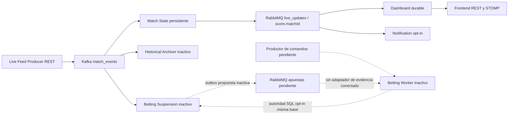

# DEV 3 — Fase 7: auditoría actual y cierre condicionado

Fecha: 2026-11-16. Resultado global: **BLOQUEADO para integración completa y aceptación de apuestas**. Código preparado para revisión con restricciones; no equivale a certificación de producción. Esta ejecución realizó inspección y pruebas locales, no pruebas nuevas de mensajería ni migraciones reales.

## 1. Git y cambios incorporados

- Rama `integration/Valeria-mvp-dev`, HEAD `3e89b86`. Árbol inicialmente limpio. `git fetch origin` ejecutado; `HEAD...origin/dev`: **0 locales / 0 remotos**. No faltan commits de `origin/dev`.
- DEV 3 está incorporado mediante `79de3f9`; `018e4b1` es una referencia histórica, no HEAD. El tracking de esta rama sigue en `018e4b1`; HEAD tiene tres commits adicionales.
- La rama `origin/integration/Juan-Gabriel-validation` conserva `9cc4aca` sin integrar. Su endpoint alternativo `POST /api/integration/events` no es requisito faltante: el productor actual ya implementa `POST /api/matches/{matchId}/events`. No se mezclaron APIs ni ramas.
- Inspeccionados los archivos actuales, no solo mensajes: `7db4ece` y `8cae79d` preparan integración de notificaciones y React; el frontend contiene recuperación REST + STOMP, pruebas de reconexión y revisión durable. Notification tiene inbox/alertas persistentes, recuperación AMQP y pruebas externas condicionadas, no es un esqueleto.
- **Regresión de infraestructura fuera de DEV 3:** `bec2fd3`, incorporado en `3e89b86`, elimina `tests/9f/`, `scripts/start-mvp.sh`, `scripts/check-mvp.py` y evidencias históricas. El Compose principal todavía remite al script eliminado para preparar passwords. No se restauró ni modificó nada fuera de alcance.

## 2. Inventario y topología efectiva

Hay siete servicios Java: producer, match-state, dashboard, notification y los tres de DEV 3. React/Vite está en `services/dashboard-frontend`. Todos los POM declaran Java 17; seis usan Boot 3.5.7, **notification-backend declara 4.1.2**. Es una diferencia de plataforma que DEV 2 debe validar; no demuestra por sí sola incompatibilidad JSON. No se cambió su POM.



Historical y Suspension son consumidores **paralelos** de Kafka con grupos propios, no pasos posteriores de Match State. Worker no consume score updates ni convierte una notificación de suspensión en una autorización. Notification no alimenta actualmente al frontend de apuestas.

| Componente | Persistencia y recuperación | Interfaces y activación actual |
|---|---|---|
| Producer | IDs de evento conservables; confirmación Kafka; no estado de marcador | `POST /api/matches/{matchId}/events`, simulador opt-in |
| Match State | PostgreSQL, deduplicación, outbox/custodia y cuarentena; V1–V3 | Kafka `match_events`, grupo propio; publica `live_updates`, `score.{matchId}` |
| Dashboard | esquema `dashboard`, inbox/proyección y epoch durable V1–V2; modo memoria separado | REST catálogo/detalle/evento y `GET /api/matches/{matchId}/score`; STOMP `/ws`, `/topic/matches/{matchId}/score` |
| Notification | esquema `notification`, inbox/alertas V1; recuperación/DLQ | `GET /api/alerts?match_id=...`; storage y mensajería false por defecto; cola `notification.score-updates` |
| Archiver | esquema `archiver`, V1–V2; recibo por posición y evento por `(match_id,event_id)` | `GET /api/history/matches/{matchId}/events`; grupo `historical-archiver`; consumidor false |
| Suspension | esquema `betting_control`, V1–V2; ledger/revisiones/cierre/outbox/autoridad/lease | `GET /api/betting/matches/{matchId}/status`; grupo `betting-suspension-service`; consumo/publicación false |
| Worker | esquema `betting_worker`, V1–V2; inbox/operación/guard/evidencia/autorización | `GET /api/betting/operations/{operationId}`; consumo/aceptación false; modo atómico disabled |

Compose principal: PostgreSQL 17, Kafka 3.9.1 KRaft (sin ZooKeeper), RabbitMQ 4-management, producer/match-state/dashboard. No incluye DEV 3 ni Notification ni React como servicios. El POM raíz tampoco agrega DEV 3; se construyeron sus tres POM explícitamente.

## 3. Matriz de contratos actuales

| Conexión / dato | Estado | Evidencia y límite |
|---|---|---|
| Producer → Kafka → Match State | Compatible solo por inspección actual | `KafkaMatchEventPublisher`, `MatchEventMessage`: topic `match_events`, clave String matchId, JSON snake_case |
| Kafka → Archiver / Suspension | Compatible y verificado localmente con fixtures; actual por inspección | Ambos `JsonEventDecoderTest` y modelos; los fixtures son capturas conservadas, no eventos publicados hoy |
| Match State → Dashboard / Notification | Compatible solo por inspección en esta ejecución | `RabbitScoreUpdatePublisher`, `ScoreProjection`, `ScoreUpdateCodec`; exchange topic `live_updates`, routing `score.{matchId}` |
| Identidad deportiva | Existente en código; aprobación compartida pendiente | `(match_id,event_id)` en DEV 3; IDs opacos, no exigir UUID. Posición Kafka identifica recibo, no sustituye identidad de negocio |
| VAR para marcador | Existente | `reference_event_id` apunta al GOAL en anulación; CLEAR describe marcador, no permiso de apuestas |
| Correlación/cierre VAR para apuestas | Pendiente de aprobación y adaptador no implementado | Revisión identificada por VAR_CHECK; cierre interno `ReviewClosure` exige revisión, continuación posterior, versión, actor y motivo. MATCH_CONTINUES aislado no abre |
| Suspensión → RabbitMQ | Propuesto, pendiente de aprobación | Outbox `schema_version=1`, `message_id`, `match_id`, `version`, eventos BETTING_SUSPENDED/RESUMED. Exchange/routing vacíos; no enlazarlos a `live_updates` por suposición |
| Comandos → Worker | Propuesto, productor no implementado | `schema_version=1`, command_id, operation_id, match_id, simulated_user_id, timestamp; exchange/cola sin aprobar. No incluye dinero |
| Evidencia OPEN / autorización | SQL preparado; contrato/liveness pendiente | Base/epoch/revisión/lease vigente. No hay verificador de catch-up ni emisor conectado. OPEN leído, CLEAR o BETTING_RESUMED no autorizan |
| Operación Worker | Implementado localmente | RECEIVED → ACCEPTED/REJECTED/BLOCKED/FAILED; terminal durable, conflicto de identidad auditado. ACCEPTED requiere modo atómico y flags explícitos |

Evento Kafka actual sin versión explícita: `event_id`, `match_id`, `event_type`, `minute` entero 0–130 y `timestamp` ISO/Instant obligatorios; `team_id` obligatorio en GOAL; `reference_event_id` obligatorio en GOAL_ANNULLED; ambos pueden ser null/ausentes cuando no son obligatorios. Eventos exactos: GOAL, VAR_CHECK, GOAL_ANNULLED, MATCH_CONTINUES. Clave debe coincidir con match_id. DEV 3 rechaza campos desconocidos, tipos coercionados, JSON duplicado o malformado; agregar campos/versiones requiere coordinar consumidores antes de desplegar.

Salida score: match_id, event_id, event_type, home_score/away_score enteros, var_status CLEAR/IN_PROGRESS, updated_at ISO, reference_event_id opcional. No contiene autorización de apuestas ni revisión de autoridad. Los cuatro archivos `contracts/events/*.schema.json` siguen con **0 bytes**. Los esquemas bajo docs de DEV 3 son propuestas, no contratos aprobados.

## 4. Persistencia, fallos y atomicidad

Referencias revisadas: `JdbcArchiveStore`, `JdbcSuspensionStore`, `MarketState`, `JdbcWorkerStore`, `JdbcAtomicAuthorization`, `JdbcOpenLeaseIssuer`, ambas migraciones V2 y configuraciones de transacción.

- Archiver confirma recibo y archivo/cuarentena juntos; conflictos no sobrescriben eventos. Consulta paginada usa snapshot REPEATABLE READ. Suspension bloquea fila market_state y persiste ledger/estado/outbox en una transacción. Reinicio no depende de memoria; esa recuperación real aún requiere PostgreSQL.
- Kafka usa bytes crudos, ack por registro después de persistir, auto-commit desactivado. Inválidos se conservan en PostgreSQL; fallo de almacenamiento no confirma offset. Archiver y Suspension agotan cuatro entregas y pausan para intervención, sin descarte silencioso. Esto retiene disponibilidad limitada hasta recuperación operativa.
- Outbox de Suspension conserva message_id, usa confirms/mandatory y solo marca publicación tras confirmación. Confirmación incierta permite reentrega: no hay exactly-once entre PostgreSQL y RabbitMQ. Worker deduplica command_id, protege operation_id y conserva mensajes inválidos. Tras cuatro intentos detiene listener y reencola; no se inventa una DLT desplegada.
- Modo atómico requiere **misma base**, no solo mismo servidor. Los defaults control/worker apuntan a bases distintas: no habilitarlo así. El worker adquiere lock de autoridad antes del guard/operación; Suspension/emisor bloquean esa misma fila sin tomar locks del worker. READ COMMITTED y timeout 5 s en configuraciones.
- Autorización + terminal + evidencia + inbox se confirman en el mismo TransactionTemplate/DataSource. `record_atomic_authorization` revalida bajo lock; dos triggers diferidos exigen grant y ACCEPTED en el mismo backend/txid con vigencia DB. Una suspensión ya confirmada antes del lock impide aceptación posterior. Un VAR todavía en Kafka no equivale a suspensión confirmada.
- Funciones SECURITY DEFINER con search_path fijo, tablas cualificadas y EXECUTE público revocado. Preflight rechaza permisos de escritura en autoridad/grants y CREATE en esquemas. **No se auditaron owners, membresías ni ACL de una instalación real DEV 3**. App no debe ser owner/superusuario; requiere owners NOLOGIN y migrador separado.
- Lease máxima 5 s, revisión/epoch exactos; UNKNOWN/SUSPENDED/lease expirada/fuente caída fallan cerrados. El emisor interno no verifica checkpoint Kafka ni tiene bean/endpoint/scheduler. No conectarlo hasta aprobar e implementar liveness. Lectura OPEN sola nunca concede grant en `JdbcWorkerStore`.

Atomicidad: **coherente por inspección y pruebas locales, NO certificada**. Las pruebas preparadas con dos conexiones cubren ambos órdenes de suspensión/aceptación, duplicados, expiración, UNKNOWN, reinicio lógico, permisos, rollback, triggers y deadlock/reintento. No sustituyen reinicios físicos del broker/DB ni validación de lag.

## 5. Entorno encontrado y autorización pendiente

Se ejecutó únicamente `docker ps` y `docker inspect` con formato restringido (sin variables/credenciales). Existen MVP, entornos históricos y `live-jvg-integration`; no se iniciaron/detuvieron contenedores ni consultaron/modificaron filas de usuario.

Integration usa `/private/tmp/live-jvg-merge-validation/compose.json`, red `live-jvg-integration_default`, volúmenes `live-jvg-integration_postgres_data`, `live-jvg-integration_kafka_data_isolated`, `live-jvg-integration_rabbit_data`; montajes observados separados del MVP. PostgreSQL 19534, Kafka 19492, Rabbit 19573/19673, dashboard 18082, producer 18083, todos publicados en loopback. PostgreSQL 17/Kafka 3.9.1/Rabbit 4-management observados por imagen. Esto acredita separación de recursos visible, **no una base fresca ni autorización para reutilizar datos existentes**. No hay DEV 3 desplegado ni roles de prueba verificados. El Compose sobreviviente está fuera de Git y no sustituye el entorno reproducible eliminado de `tests/9f`.

Falta autorización expresa para crear bases nuevas/roles dedicados en un recurso concreto, aplicar allí las seis migraciones DEV 3, conceder permisos y ejecutar las pruebas externas. No se activaron variables de aprobación para eludirla. No se ejecutaron eventos GOAL/VAR, reinicios ni migraciones en esta fase. Las pruebas históricas reportadas del MVP no se atribuyen a esta ejecución ni certifican DEV 3.

## 6. Pruebas ejecutadas y evidencias

Las seis ejecuciones Maven concluyeron BUILD SUCCESS, usando Java **17.0.20.1**, Maven 3.10.0 y caché offline existente. Java/Maven sin variables de entorno seleccionan otras versiones en esta terminal; se fijó JAVA_HOME explícitamente. XML Surefire confirma Java 17.

| Módulo | Casos encontrados | Exitosos | Omitidos | Fallos | Errores | test / package |
|---|---:|---:|---:|---:|---:|---|
| historical-archiver | 69 | 68 | 1 | 0 | 0 | PASS / PASS |
| betting-suspension-service | 94 | 93 | 1 | 0 | 0 | PASS / PASS |
| betting-worker | 98 | 86 | 12 | 0 | 0 | PASS / PASS |
| Total único | 261 | **247** | **14** | **0** | **0** | seis builds satisfactorios |

Package vuelve a ejecutar las mismas pruebas: no se suman como casos distintos. Omitidas: tres clases PostgreSQL de persistencia y once casos de atomicidad. No son éxitos. Pruebas reales nuevas: ninguna ejecutada, todas pendientes; no hay fallo de infraestructura medido por estas omisiones.

Comando usado por módulo y por goal (`test`, después `package`):

```bash
JAVA_HOME=/Library/Java/JavaVirtualMachines/temurin-17.jdk/Contents/Home \
PATH=/Library/Java/JavaVirtualMachines/temurin-17.jdk/Contents/Home/bin:/opt/homebrew/bin:$PATH \
mvn -o -Dmaven.repo.local=/private/tmp/live-jvg-archiver-m2 \
  -f services/historical-archiver/pom.xml test
```

Se sustituyó el módulo por suspension/worker y el goal por package, sin infraestructura externa. `docs/evidence/phase-7-local-results.json` guarda los seis comandos, hashes SHA-256 de logs locales, versión Java, conteos y nombres de casos omitidos. Logs completos en `/private/tmp/live-jvg-dev3-phase7/`; XML en target/surefire-reports, ambos artefactos locales no destinados al PR. No contienen evidencia de brokers reales.

## 7. Defectos, restricciones y correcciones

| Prioridad / naturaleza | Hallazgo | Acción / responsable |
|---|---|---|
| Crítica, dependencia | Sin contratos de apuestas aprobados, caller de cierre ni verificador/emisor de leases operativo | Aprobar semántica con equipo; implementar dentro de DEV 3 después de decisión. No abrir por MATCH_CONTINUES ambiguo |
| Crítica, validación pendiente | Migraciones/roles/atomicidad sin prueba PostgreSQL real | DBA/responsable autoriza recursos nuevos y pruebas; acceptance false |
| Alta, defecto fuera de alcance | Compose remite a `scripts/start-mvp.sh` eliminado; desaparece `tests/9f` | Responsable de infraestructura/DEV 1: restaurar preparación reproducible en cambio separado; no recrear volúmenes existentes |
| Media, configuración | Archiver y Notification tienen default HTTP 8082 | Usar perfil DEV 3: 18882/18883/18884, o ARCHIVER_PORT explícito. No hay conflicto entre contenedores por puerto interno; no requiere cambiar código |
| Media, diferencia comprobada | Notification Boot 4.1.2 frente a 3.5.7 | DEV 2 confirma soporte/build del módulo; no cambiar versión para ocultarlo |
| Dependencia | No productor real de comandos, ni topología Rabbit aprobada de apuestas | Equipo define exchange/cola/routing, productor y contrato. No reutilizar cola de dashboard |
| Riesgo no certificado | Ventana de confirmación, lag previo al lock, roles y relojes reales | At-least-once + deduplicación; prueba real y aprobación de punto de autorización |

No se encontró defecto funcional interno reproducible que justificara cambios en producción en esta ejecución. Se conservó el comportamiento seguro y se añadieron únicamente este informe y el JSON de evidencias. No se cambiaron fuentes, POM, contratos, perfiles, Compose ni flags. No se realizaron refactorizaciones ni correcciones especulativas.

## 8. Plan exacto para terminar

1. Responsable aprueba identidad/VAR/cierre, eventos de suspensión, comandos, versionado y política de liveness. Aprobar base común control/worker; archiver puede tener base independiente.
2. Autorizar recurso aislado concreto y **bases NUEVAS** `dev3_it_archiver_<token>`, `dev3_it_betting_control_<token>` y bases nuevas `dev3_it_betting_worker_<token>` separadas para persistencia y atomicidad. Proveer roles migradores dedicados y rol restringido `dev3_it_worker_<token>`. No usar DB/roles del MVP. Puertos deben cumplir los guards de `IsolatedPostgres`.
3. Aplicar V1/V2 por esquema bajo propietarios correctos; control antes de worker para prueba atómica. Revisar grants/owners/membresías y rechazo de datos ACCEPTED antiguos por V2. No hay migraciones duplicadas dentro de cada módulo; iguales versiones en esquemas independientes son intencionales.
4. Ejecutar las pruebas PostgreSQL preparadas con `DEV3_RUN_POSTGRES_TESTS=true`, aprobación de migración y variables privadas `DEV3_IT_DB_URL/USERNAME/PASSWORD`. Para atomicidad usar otra base fresca, `DEV3_RUN_ATOMIC_POSTGRES_TESTS=true`, `DEV3_ATOMIC_WORKER_USERNAME/PASSWORD` y `-Dtest=AtomicPostgresConcurrencyTest`. Variables no son por sí mismas permiso del usuario. Procedimiento y grants detallados: `phase-6-atomic-security.md`.
5. Entorno de proceso: perfil `dev3-integration`, variables DEV3_* descritas en los tres `application-dev3-integration.properties`, HTTP 18882/18883/18884, fuente/grupos propios y conexiones explícitas. Flyway/consumo/publicación/aceptación permanecen false; readiness `/actuator/health/readiness` no prueba liveness. Todos necesitan esquema ya migrado para arrancar; no prometer arranque sin DB.
6. Autorizar integración Kafka/Rabbit separada, conservar topics/colas/IDs únicos, habilitar solo consumo de archiver/suspension primero. Probar GOAL → VAR_CHECK → GOAL_ANNULLED y GOAL → VAR_CHECK → MATCH_CONTINUES: archivo correcto y mercado todavía cerrado sin cierre explícito autorizado. Verificar cuarentena, deduplicación, ack después de commit y recuperación.
7. Implementar y probar adaptador de cierre y verificador de catch-up/lease aprobado. Verificar incertidumbre de confirms y recuperación. Solo después aprobar topología/productor de comandos, publicación y finalmente aceptación atómica simulada. Repetir con rol restringido y prueba end-to-end; una lectura de estado no basta.

## 9. Estado de entrega

| Componente | Implementado | Probado localmente | Probado con infraestructura real en esta fase | Bloqueos |
|---|---|---|---|---|
| Historical Archiver | Sí, inactivo por defecto | 68 PASS | No | Migraciones/consumo real autorizados |
| Betting Suspension | Motor, persistencia y outbox; adaptadores de cierre/lease pendientes | 93 PASS | No | Contratos, liveness, cierre y PostgreSQL |
| Betting Worker | Worker durable y autorización SQL opt-in | 86 PASS | No | Contratos/productor, DB común/ACL, pruebas atómicas |
| DEV 1 / DEV 2 / frontend | Implementación existente inspeccionada | No se reejecutaron sus suites | No; contenedores observados, no flujo certificado | Infra reproducible y validación con DEV 3 |

Preparación para PR: informe/evidencia revisables, cambios limitados al módulo autorizado, sin commit/push. Código previo ya está incorporado; este documento no certifica su despliegue. Preparación para demo: MVP existente no se alteró, pero una demo completa de DEV 3 con aceptación segura **no está lista**. Se requieren los permisos y resultados anteriores. No se solicitó al usuario ejecutar comandos manuales ni se utilizaron credenciales privadas.
