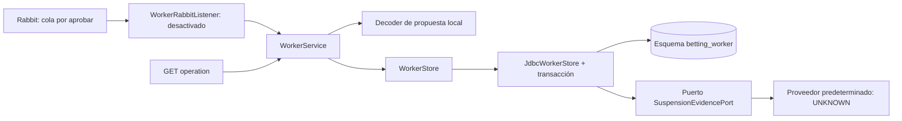
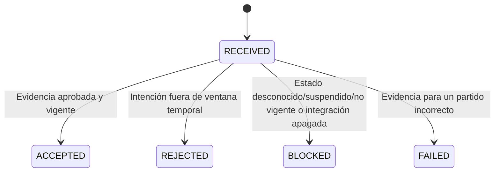

> Estado actual Fase 6: V1 + V2 requeridas, aún no aplicadas. La evidencia OPEN por lectura ya no basta: ACCEPTED requiere sesión PostgreSQL atómica y autorización en el mismo commit. Mode disabled y aceptación false; no hay integración real certificada. Ver ../../betting-suspension-service/docs/phase-6-atomic-security.md.

# Betting Worker — DEV 3, Fase 4

Procesador durable de operaciones **simuladas**, Java 17 / Spring Boot 3.5.7. No procesa dinero, pagos, cuotas, premios ni proveedores comerciales. Contratos de entrada/evidencia pendientes: consumidor y aceptación **desactivados por defecto**.

## Arquitectura



`domain`: comando simulado, operación, evidencia/guard y política de aceptación. `application`: servicio y puertos. `infrastructure`: JDBC, decoder, configuración, comprobación de esquema y recuperación Rabbit. `entrypoint`: listener y API de consulta. No hay dependencia Java de Historical Archiver ni Betting Suspension Service.

Dependencias necesarias: Web, Validation, Actuator, JDBC, AMQP, PostgreSQL, Flyway core/PostgreSQL y Boot Test. Sin Kafka (el worker no lo consume), JPA, DB emulada ni tecnología adicional. Versiones exactas en `evidence/dependencies.txt`.

## Modelo y transiciones

Identidades globales dentro del worker: `command_id` y `operation_id`. IDs de partido y usuario simulado son strings no vacíos; no se exige UUID. El usuario simulado no se consulta en plataformas externas ni se vincula a una cuenta de dinero.



- Se conservan identificadores, timestamp del comando, recepción/actualización, razón y versión.
- RECEIVED comienza en versión 0; un resultado terminal pasa a versión 1. Todas las transiciones posteriores desde un terminal se rechazan.
- RECEIVED, decisión, evidencia y terminal se escriben en **una transacción**. Normalmente la fila visible tras commit ya es terminal; el historial conserva RECEIVED y la transición final.
- Los terminales son inmutables. Reentregar una operación BLOCKED no la acepta después de una reanudación. Una nueva intención necesita identidades nuevas, no un retry que cambie el significado de la primera.
- Un fallo PostgreSQL no se convierte en FAILED y se confirma: revierte la transacción y conserva la entrega Rabbit para recuperación. FAILED representa un fallo de protocolo interno procesable, como evidencia para otro partido; no oculta pérdida de persistencia.

## Propuesta local de comando, NO contrato compartido aprobado

El archivo compartido `contracts/events/betting-command.schema.json` permanece vacío. No existe un productor de comandos aprobado que se pueda declarar integrado. Este decoder es una propuesta local para pruebas y futura revisión; no se publicaron mensajes reales.

Ejemplo ilustrativo, no evidencia de ejecución:

```json
{
  "schema_version": 1,
  "command_id": "sim-command-001",
  "operation_id": "sim-operation-001",
  "match_id": "match-001",
  "simulated_user_id": "sim-user-001",
  "timestamp": "2026-11-15T00:00:00Z"
}
```

Todos los campos son obligatorios, strings no vacíos salvo schema_version entero 1; timestamp válido como Instant. El decoder rechaza campos desconocidos, JSON duplicado/incompleto, UTF-8 inválido, tokens extra y coerciones. No permite incluir `market_status`, pruebas de apertura, cantidades o datos financieros para forzar aceptación.

Identidad de comando comparada mediante JSON estructural ordenado: ignora espacios/orden de claves, conserva valores textuales. El mismo command_id con contenido distinto se audita como conflicto, nunca reemplaza la decisión original. Otro command_id reutilizando operation_id también es conflicto y no crea otra operación. La API devuelve el command_id original: no interpretar una operación existente como aceptación de un comando conflictivo posterior.

## Evidencia de suspensión: cierre seguro por defecto

`SuspensionEvidencePort.fetch(matchId)` es la frontera de integración. El proveedor predeterminado devuelve UNKNOWN. **No hay cliente HTTP que convierta ingenuamente el GET de Betting Suspension Service en permiso para apostar**, ni consumidor de su outbox. Ese servicio ofrece estado durable, pero su contrato provisional no aporta epoch, autoridad verificada o validez temporal suficiente para el modelo de aceptación del worker.

La interfaz interna `MarketEvidence` propone partido, autoridad, epoch, revisión monotónica, estado, emisión y vencimiento. Un objeto Java con estos campos **no es una prueba criptográfica ni un contrato externo aprobado**: un futuro adaptador debe autenticar la fuente y garantizar su semántica. El puerto no recibe evidencia del comando de apuesta.

Reglas implementadas:

1. SUSPENDED y UNKNOWN bloquean. Fuente ausente, excepción o null bloquean; no hay fallback a una apertura guardada.
2. OPEN solo se considera con fuente/epoch, revisión positiva y evidencia de vida finita. Debe estar vigente al decidir, no emitida en el futuro y tener antigüedad y duración máximas de 5 segundos por defecto.
3. `worker.acceptance.enabled=false` impide aceptar incluso una prueba OPEN válida. Habilitarlo sin cambiar el proveedor predeterminado sigue produciendo UNKNOWN/BLOCKED.
4. Comandos con timestamp futuro o antigüedad superior a 5 minutos se rechazan, como política local provisional. No se recalifica un comando terminal reentregado.
5. El guard durable conserva la mayor revisión observada por partido. OPEN inferior a una suspensión más reciente se bloquea y no reemplaza el guard.
6. La misma revisión con datos idénticos no renueva el vencimiento. Misma revisión con otro estado/tiempo congela el guard y bloquea, hasta reconciliación explícita futura.
7. Cambio de autoridad o epoch no reinicia automáticamente la revisión: congela el guard. No existe endpoint para borrar el fence o forzar apertura.
8. Evidencia de otro partido produce FAILED sin aceptación. El dato observado se conserva para diagnóstico restringido.

La política requiere revisiones monotónicas **de la evidencia**; no tratar automáticamente el `version` actual del servicio de suspensión como una versión de lease renovable. Esa correspondencia y la renovación de pruebas con el mismo estado deben acordarse antes de construir un adaptador. Saltos hacia una revisión superior son posibles; no se exige continuidad de todos los mensajes.

La evaluación usa el reloj después de terminar la consulta al puerto: una respuesta lenta no conserva artificialmente la vigencia del inicio de la transacción. La verificación se refiere al instante de decisión, no certifica un deadline físico del commit ni sincronización perfecta de relojes.

### Carrera distribuida pendiente

Freshness y guard local solo garantizan que no se ignora una suspensión **ya observada**. No garantizan que no haya un VAR o suspensión aún en tránsito, ni hacen atómica una consulta HTTP y la ejecución en otro servicio. Para habilitar aceptación real simulada se necesita aprobar una autoridad que serialice control e intenciones con fencing/lease verificable, o un protocolo equivalente con punto de decisión claramente definido. TTL y caché por sí solos no solucionan esa carrera.

Por ello el procesamiento que pudiera aceptar apuestas incorrectamente queda sin adaptador externo y deshabilitado. Las pruebas positivas utilizan un proveedor simulado explícitamente aprobado para probar el dominio, no una conexión real certificada.

## Persistencia JDBC y recuperación

Preparada `src/main/resources/db/migration/V1__simulated_operations.sql`. **No ejecutada**. Esquema exclusivo `betting_worker`; historial Flyway en `betting_worker.flyway_schema_history`.

| Tabla | Propósito |
|---|---|
| market_guard | Autoridad/epoch/revisión, estado, vida de evidencia, congelación y versión local de fence |
| command_inbox | Identidad, payload original/canónico, resultado durable e intentos de entrega |
| operation | Usuario simulado, partido, estado/razón, versión y timestamps |
| operation_transition | RECEIVED y resultado terminal con versión |
| operation_evidence | Prueba observada, guard usado, disponibilidad, decisión e instante |
| message_audit | Invalidación/conflicto con body exacto, headers, broker ID y destino |
| operation_authorization | Fase 6: permiso ligado al backend/transacción y operación, con control diferido de commit |

Flujo transaccional: reclamar command_id con INSERT ON CONFLICT; cargar el inbox existente con FOR UPDATE si es reentrega; bloquear la fila market_guard del partido; insertar operation_id único; consultar/evaluar evidencia; persistir guard/evidencia/terminal/historial y finalizar inbox. WHERE version protege las actualizaciones. Un error o escritura obligatoria de cero filas revierte todo.

Las operaciones concurrentes del mismo partido se serializan por guard; unicidad de command_id y operation_id evita doble procesamiento incluso entre partidos. No hay una fuente de verdad en memoria ni reintento que cambie un resultado aceptado. Se lee PostgreSQL al consultar una operación nueva instancia del adaptador.

Esto implementa un protocolo JDBC; su aislamiento, unicidad y locks efectivos en PostgreSQL 17 quedan por comprobar con autorización. No se certificó recuperación real ni ejecución concurrente de dos procesos PostgreSQL en esta fase.

## RabbitMQ, reintentos y ack

- Exchange, cola y source_id configurables. Sin nombres compartidos predeterminados, bindings, Queue/Exchange beans ni creación de topologías: `spring.rabbitmq.dynamic=false`.
- Listener solo se registra con `worker.consumer.enabled=true`; exchange y cola deben ser no vacíos. No empieza automáticamente. Se verifican las seis tablas y luego se solicita arranque explícito.
- La cola debe existir; ausencia fatal. Un consumidor, prefetch 1 y acknowledgement AUTO: retorno normal solo después de commit del store.
- Exchange recibido distinto al configurado: cuarentena durable sin procesar el comando. Routing key, ID Rabbit, body y headers se preservan. Delivery tag no se usa como identidad durable, porque cambia con la entrega.
- Message inválido: audit row confirmada antes del retorno; no se arroja para descartar ni se confirma si la DB falla. Reentrega de un inválido después de ack incierto puede producir varias filas de auditoría, nunca varias operaciones.
- Fallos transitorios de almacenamiento: máximo cuatro invocaciones por ciclo (100/200/400 ms de espera). Si luego funciona, termina normalmente. Si se agotan, el recoverer solicita detener este listener y lanza ImmediateRequeueAmqpException para conservar la entrega.
- Recuperación manual tras reparar causa: reiniciar este servicio. No hay scheduler que lo vuelva a arrancar creando bucles infinitos, ni recoverer que descarte un mensaje no guardado.
- Si falla un ack después del commit, puede haber reentrega; el inbox retorna el resultado durable sin llamar otra vez a la fuente de suspensión. No se promete exactly-once entre PostgreSQL y RabbitMQ.

El puerto futuro debe tener timeout acotado: se consulta mientras se mantiene una transacción/lock del partido. No se implementaron llamadas externas con timeout inexistente.

## API de consulta

`GET /api/betting/operations/{operationId}`

HTTP 200: `operation_id`, `command_id`, `match_id`, `state`, `reason`, `version`, `timestamp`, `received_at`, `updated_at`. JSON snake_case. No expone simulated_user_id, payloads, headers o prueba de suspensión.

Operación inexistente: 404; identificador vacío o mayor que 512 caracteres: 400; DB/transacción o fila inconsistente: 503 con mensaje genérico. No hay creación por REST, reapertura, borrado o actualización de operaciones. Antes de exposición fuera del entorno local debe acordarse autenticación/autorización.

## Configuración

| Variable | Predeterminado |
|---|---|
| BETTING_WORKER_PORT | 8084 |
| BETTING_WORKER_DB_URL | jdbc:postgresql://localhost:5432/betting_worker |
| BETTING_WORKER_DB_USERNAME | betting_worker |
| BETTING_WORKER_DB_PASSWORD | Vacío; secreto local, nunca commit |
| BETTING_WORKER_CONSUMER_ENABLED | false |
| BETTING_WORKER_ACCEPTANCE_ENABLED | false |
| BETTING_WORKER_EXCHANGE / QUEUE | Vacíos; recursos por aprobar |
| BETTING_WORKER_SOURCE_ID | local/1; identidad de broker/entorno para auditoría |
| RABBITMQ_HOST / PORT / USERNAME / PASSWORD | localhost / 5672 / guest / vacío |

Propiedades locales: `worker.evidence.max-age=5s` y `worker.command.max-age=5m`, políticas provisionales. El puerto publicado Rabbit del MVP es 5673 y PostgreSQL 55434: no confundirlos con defaults genéricos ni usar sus datos para pruebas.

Flyway está desactivado. Sin DB/esquema preparados el servicio falla el arranque, no migra ni degrada a memoria. Verificar tablas con SELECT no demuestra que se haya ejecutado una versión de migración aprobada.

## Pruebas locales

```bash
export JAVA_HOME="$(/usr/libexec/java_home -v 17)"
export PATH="$JAVA_HOME/bin:/opt/homebrew/bin:$PATH"
mvn -version
mvn -f services/betting-worker/pom.xml test
mvn -f services/betting-worker/pom.xml package
```

Esta sesión usa offline la copia escribible existente `/private/tmp/live-jvg-archiver-m2`, sin borrar artefactos ni detener procesos. Mockito subclass MockMaker evita depender de un agente dinámico. No se ejecutaron brokers, contenedores ni Flyway.

Tests de política, decoder y transiciones sin infraestructura; JDBC/transacciones/locks solicitados con mocks; retry interceptor real invocado sobre un target local y registry/container simulados; REST con MockMvc; reinicio simulado mediante nueva instancia de adaptador leyendo filas simuladas persistentes. No confundir esos resultados con recuperación o confirmación Rabbit/PostgreSQL reales.

Resultados e inventario: `verification.md`, `files-created.txt` y `evidence/`.

## Condiciones pendientes para integración final

1. Aprobar el comando, identidades, ventanas temporales y reglas de terminales; no modificar el schema compartido desde este módulo.
2. Aprobar una autoridad de suspensión, epoch/revisión, renovación de vigencia, fencing y solución a carreras. Construir el adaptador del puerto solo después; no conectar sin más el REST/outbox provisional actual.
3. Aprobar DB/usuario/esquema propio y ejecutar V1 con autorización separada. Definir backup, acceso y retención a auditoría raw/pseudónimos, que pueden contener datos recibidos accidentalmente sensibles.
4. Aprobar exchange/cola/binding propios y permisos; no competir por colas del dashboard ni modificar topologías del equipo.
5. Autorizar pruebas reales aisladas de idempotencia, rollback, ack incierto, reentrega, orden de suspensión, freshness y reinicio. Verificar redes/volúmenes efectivos antes de usar recursos, no solo nombres de proyecto.
6. Revisar protección del endpoint y decisión de aceptación con los tres servicios DEV 3. No se activó ni avanzó a integración real en esta fase.

Preparación Fase 5 y diseño de sustitución del permiso OPEN basado solo en lectura: `../../betting-suspension-service/docs/phase-5-integration-preparation.md`. Perfil aislado y pruebas PostgreSQL preparados, no activados.

Fase 6: ver `../../betting-suspension-service/docs/phase-6-atomic-security.md`. El worker exige autorización transaccional antes de ACCEPTED; los componentes y las pruebas PostgreSQL están preparados, inactivos y no certificados en infraestructura real.
