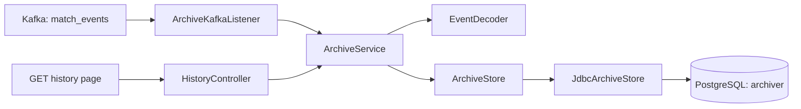

> Actualización JPA: el adaptador predeterminado es ahora `JpaArchiveStore`, con Spring Data JPA/Hibernate y PostgreSQL real verificado en un laboratorio nuevo. `ARCHIVER_STORAGE_ADAPTER=jdbc` selecciona el respaldo exclusivo. Véase [arquitectura, configuración y evidencias actuales](jpa-adapter-validation.md). El contenido de Fase 2 que sigue es histórico y describe la implementación JDBC inicial; no sustituye el estado actual ni los contratos integrados posteriormente.

# Historical Archiver — implementación DEV 3, Fase 2

Estado: implementación y verificación local sin brokers/DB reales. Formato consumido **provisional**, basado en el código y evidencias del productor; no se aprobaron ni modificaron contratos compartidos.

## Alcance y arquitectura

Java 17, Spring Boot 3.5.7. Solo se modifica `services/historical-archiver/`. No hay cambios en DEV 1, DEV 2, apuestas, Compose principal o contratos. No se iniciaron contenedores ni se ejecutó Flyway.



- `domain`: evento deportivo, evidencia de transporte inmutable, resultados y página histórica. Sin dependencias Spring/Kafka/JDBC.
- `application`: `ArchiveService` y puertos `EventDecoder`, `ArchiveStore`.
- `infrastructure`: decoder JSON, JDBC/transacciones, configuración, verificación de esquema y política de reintentos.
- `entrypoint`: listener Kafka, controlador REST y errores HTTP.

No se usa JPA: JdbcTemplate permite controlar `ON CONFLICT`, bytes originales, límites SQL y fronteras transaccionales sin entidades adicionales. Dependencias directas: Web, Validation, Actuator, JDBC, Spring Kafka, PostgreSQL, Flyway core/PostgreSQL y Boot Test. Versiones administradas por Boot; sin nueva dependencia de runtime ni test para simular PostgreSQL con otro motor.

## Compatibilidad consumida

Se inspeccionaron los DTO `MatchEvent` del productor/consumidor, `KafkaMatchEventPublisher` y la propuesta local `services/live-feed-producer/docs/match-event.schema.proposed.json`. Los cuatro contratos compartidos siguen vacíos.

Topic configurable, predeterminado `match_events`. Clave Kafka UTF-8 exactamente igual a `match_id`. Valores JSON UTF-8, nombres `snake_case`:

| Campo | Tipo/validación local |
|---|---|
| event_id | String no vacío; no exige UUID |
| match_id | String no vacío; coincide con clave Kafka |
| event_type | GOAL, VAR_CHECK, GOAL_ANNULLED, MATCH_CONTINUES |
| team_id | String o null/ausente; obligatorio no vacío para GOAL |
| minute | Entero 0..130, sin coerción de cadenas/decimales |
| timestamp | Fecha ISO representable como Instant; se preservan nanosegundos |
| reference_event_id | String o null/ausente; obligatorio no vacío para GOAL_ANNULLED |

No se exige referencia para VAR_CHECK/MATCH_CONTINUES; no se infiere equipo ni se consulta el marcador. Una anulación válida que llega antes del gol se archiva como hecho: el archiver no recalcula marcador ni bloquea esperando referencias.

El decoder rechaza raíz no objeto, JSON incompleto, campos duplicados, tokens extra, UTF-8 incorrecto, enum/tipos no válidos y campos desconocidos. Esto sigue la propuesta local actual, **no una política de evolución aprobada**. Las extensiones futuras se conservan en cuarentena hasta revisar el decoder; no se descartan.

Fixtures: `src/test/resources/fixtures/producer-events.jsonl` copia sin modificar los primeros cinco payloads de `docs/evidence/mvp-final/kafka-messages.txt`. Son mensajes históricos capturados durante el MVP, no publicaciones efectuadas en esta fase. Cubren gol local, VAR, anulación, continuación y gol visitante. No se añadió dependencia Java del módulo productor.

## Identidad, duplicados y consistencia

Actualización Fase 5: identidad **(match_id,event_id)**, igual al núcleo y Betting Suspension Service. V1 se conserva como historial y V2 migra la restricción y los recibos sin borrar eventos. El mismo ID en otro partido es una identidad distinta; otro contenido para el mismo ID/partido es conflicto. No cambia el formato JSON compartido. Antes de arrancar esta versión se deben aplicar ambas migraciones con aprobación separada.

- Un evento nuevo inserta una fila y su recibo en la misma transacción PostgreSQL.
- Reentrega exacta en la misma posición retorna el resultado persistido, sin otra inserción.
- El mismo evento en otro offset no crea otra fila: el recibo nuevo queda `DUPLICATE`.
- Comparación canónica estructural: orden de claves y espacios no importan; opcionales ausentes y null son equivalentes. Los valores sí importan; distintas representaciones textuales de timestamp pueden ser conflicto aunque designen el mismo instante. Se conserva siempre el payload original exacto de cada recibo.
- Reutilización del ID/partido con otro contenido: recibo `IDENTITY_CONFLICT`, razón `EVENT_ID_REUSED`; nunca se actualiza el evento original.
- Datos inválidos: recibo `QUARANTINED` con razón `MALFORMED_JSON`, `INVALID_EVENT` o `KEY_MISMATCH`; la evidencia conserva también tombstones, clave y bytes no UTF-8.
- Identidad de transporte: `(source_id,topic,partition_id,record_offset)`. `source_id` debe identificar el log/entorno de forma estable. Cambiarlo deliberadamente tras recrear el topic/log evita colisiones de offsets antiguos. Reutilizar una posición con otro contenido provoca fallo y pausa, no sobrescritura de la evidencia previa.

El `INSERT ... ON CONFLICT` y la restricción de unicidad arbitran concurrentemente las inserciones; no se usa un check-then-insert sin protección. Recibo `PENDING`, evento y finalización de recibo forman una sola transacción: cualquier excepción revierte todo. El listener solo retorna normalmente después de que `TransactionTemplate` confirme. Fallar al almacenar/finalizar una cuarentena impide confirmar Kafka.

No hay transacción distribuida Kafka/PostgreSQL ni promesa exactly-once. Si el proceso termina después del commit DB y antes del commit Kafka, la reentrega se deduplica por recibo/identidad. La fuente durable no se sustituye por offsets ni por memoria.

## Modelo y migración preparada

Archivos: `V1__archive_events.sql` y `V2__match_scoped_identity.sql` en `src/main/resources/db/migration/`. Ninguno ejecutado. V2 conserva el contenido y completa match_id en recibos V1 antes de cambiar la FK.

- Esquema exclusivo: `archiver`, creado/gestionado en la futura operación Flyway autorizada.
- Historial propio: `archiver.flyway_schema_history`.
- `archived_event`: secuencia de ingestión, identidad, partido, tipo, equipo, minuto, timestamp deportivo como TEXT validado (preserva precisión), referencia, payload original BYTEA, JSON canónico y fecha de recepción TIMESTAMPTZ.
- `input_receipt`: posición fuente, timestamp Kafka, clave/valor originales BYTEA, headers con valores base64 (incluye repetidos/null), resultado, evento vinculado, causa y recepción.
- Índice `(match_id,seq)` para las páginas e índice parcial para revisar cuarentena/conflictos. FK del recibo vincula eventos existentes; inválidos tienen evento null.
- No se borran datos ni se añaden tareas automáticas de retención, replay o limpieza.

Por defecto `spring.flyway.enabled=false`. `StorageReadiness` solo ejecuta dos SELECT sin filas para comprobar tablas antes del consumo; no crea ni migra nada. Si falta DB/esquema, falla el arranque sin consumir. La verificación básica no sustituye un proceso de migración/revisión de permisos y versión del esquema.

## Kafka y reintentos

Grupo propio `historical-archiver`, nunca reutilizar `match-state-service`. Deserializadores byte[], `enable.auto.commit=false` forzado, `max.poll.records=1`, un consumidor por instancia, ack RECORD y commits síncronos. El listener arranca solo tras validar almacenamiento y con habilitación expresa.

`ArchiverErrorHandler`: una entrega y tres reintentos, espera fija configurable (200 ms por defecto). Tras el cuarto fallo pausa el contenedor; no recupera descartando ni confirma el registro. Se conserva el offset pendiente. El operador debe corregir almacenamiento/configuración y reiniciar este servicio para reanudar; no hay un bucle automático infinito ni endpoint administrativo nuevo. La pausa afecta a las particiones de esa instancia, límite deliberado para este alcance.

No se pausa por datos inválidos si pueden guardarse en cuarentena. Se registran partición, offset, tipo de error y resultado sin payloads, headers o mensajes de excepción. Con Kafka listener logs desactivados se evitan volcados de registros por el framework. No habilitar DEBUG con datos sensibles sin una revisión específica.

## API REST implementada

`GET /api/history/matches/{matchId}/events?page=0&size=50`

- `page`: entero desde 0, máximo representable por int.
- `size`: entero 1..200; predeterminado 50.
- `matchId`: texto no vacío, hasta 512 caracteres para esta API local.
- Orden: `seq ASC`, secuencia única de ingestión; no se ordena por el timestamp deportivo.
- Paginación real: `WHERE match_id=? ORDER BY seq ASC LIMIT ? OFFSET ?`, parámetros enlazados; offset calculado como long.
- COUNT y página en una transacción read-only REPEATABLE READ. Cada petición tiene su snapshot; distintas páginas solicitadas en momentos diferentes no forman un snapshot histórico común. OFFSET grande puede ser costoso: cursor futuro fuera del alcance actual.
- Partido sin eventos o página fuera de rango: 200 con `content: []`; no se inventa un registro de partido.
- Parámetros inválidos: 400. PostgreSQL/transacción no disponible: 503 con ProblemDetail genérico, sin mensaje interno de conexión. Otros errores de infraestructura no se convierten en páginas vacías.

Forma de respuesta (ejemplo de formato, no evidencia de una ejecución real):

```json
{
  "content": [{
    "sequence": 1,
    "event_id": "example-event",
    "match_id": "example-match",
    "event_type": "GOAL",
    "team_id": "home",
    "minute": 10,
    "timestamp": "2026-11-15T00:00:00.123456789Z",
    "reference_event_id": null,
    "received_at": "2026-11-15T00:00:01Z"
  }],
  "page": 0,
  "size": 50,
  "total_elements": 1,
  "total_pages": 1
}
```

La API pública no expone payloads/headers originales ni la cuarentena. No hay endpoint de publicación, modificación, borrado ni replay. Autenticación y autorización del despliegue quedan pendientes antes de exponerla fuera del entorno local.

## Configuración

| Variable | Valor predeterminado / propósito |
|---|---|
| ARCHIVER_PORT | 8082 |
| ARCHIVER_DB_URL | jdbc:postgresql://localhost:5432/archiver |
| ARCHIVER_DB_USERNAME | archiver |
| ARCHIVER_DB_PASSWORD | Vacío; aportar secreto por entorno, nunca commit |
| KAFKA_BOOTSTRAP_SERVERS | localhost:9092; dentro de la red Compose será kafka:9092 |
| MATCH_EVENTS_TOPIC | match_events |
| ARCHIVER_GROUP_ID | historical-archiver; usar grupo nuevo en pruebas aisladas |
| ARCHIVER_SOURCE_ID | local/1; configurar identidad estable y exclusiva del log real |
| ARCHIVER_CONSUMER_ENABLED | false; habilitar solo con DB migrada y aprobación |

En el Compose MVP actual, los puertos publicados son Kafka 19092 y PostgreSQL 55434. Estos difieren de los valores genéricos predeterminados; no apuntar accidentalmente al MVP durante pruebas. No se añadieron servicios, redes ni volúmenes al Compose. No se reutiliza su usuario de aplicación ni sus esquemas.

## Verificación local reproducible

En macOS, fijar Java 17 antes de Maven:

```bash
export JAVA_HOME="$(/usr/libexec/java_home -v 17)"
export PATH="$JAVA_HOME/bin:/opt/homebrew/bin:$PATH"
mvn -version
mvn -f services/historical-archiver/pom.xml verify
```

Las pruebas locales excluyen DataSource real y simulan exclusivamente puertos/JDBC/gestor transaccional/consumer API. No simulan un resultado de broker real ni equivalen a pruebas de PostgreSQL/Kafka. Mockito usa subclass MockMaker de test para evitar depender de un agente dinámico en el entorno restringido.

En esta sesión, la caché original no era escribible por el sandbox (fallo de lock). Se copió a `/private/tmp/live-jvg-archiver-m2`, sin borrar JAR, cambiar caché original o detener procesos; se ejecutó offline con `-Dmaven.repo.local=/private/tmp/live-jvg-archiver-m2`.

Cobertura: cinco payloads reales históricos, validación/UTF-8, referencias fuera de orden, bytes inmutables, duplicados, conflictos, rollback y cuarentena, fallo de conexión, orden de commit, límites/SQL de paginación, REST/errores, inicio condicionado al esquema y agotamiento de reintentos sin commit. Los detalles/resultados reales están en `verification.md` y `evidence/local-verification.txt`.

## Integración futura y permisos pendientes

1. Aprobar contrato provisional y identidad por partido ya alineada por V2; definir política de campos futuros y replay de cuarentena. No modificar una V1 que ya se haya aplicado para resolver cambios posteriores.
2. Aprobar un PostgreSQL dedicado o un esquema/usuario aislado con permisos exclusivos. Revisar V1 y V2 y autorizar su ejecución por separado; no basta con autorizar pruebas unitarias.
3. Verificar topología y topic reales, grupo/fuente propios, retención Kafka y backups PostgreSQL. No crear topics ni cambiar particiones automáticamente.
4. Aplicar/verificar Flyway solo con autorización; dejar el listener apagado hasta entonces. Después habilitar el consumidor explícitamente. `StorageReadiness` no es una alternativa a aplicar la migración.
5. Autorizar pruebas reales en recursos aislados: inspeccionar nombres efectivos de redes/volúmenes y membresía de contenedores antes de publicar. Verificar escritura, ack, reinicio, duplicados, conflictos, DB caída y cuarentena sin pérdida. No tocar datos ni detener brokers compartidos.
6. Preparar la incorporación a Compose mediante una propuesta revisada, sin modificar el principal en esta fase. No se necesita RabbitMQ para archivar.

No se implementó replay automático, API administrativa de cuarentena, autenticación ni política de retención. Los bytes inválidos permanecen en DB para revisión; al actualizar el decoder un registro ya en cuarentena no se reprocesa automáticamente. Cambiar source_id no es una herramienta de replay ni autoriza descartar evidencia. Estas limitaciones no se presentan como funcionalidades completadas.

La Fase 2 termina aquí: Betting Suspension Service y Betting Worker no se han modificado ni iniciado.

Preparación actualizada y condiciones de integración: ver `../../betting-suspension-service/docs/phase-5-integration-preparation.md`. El perfil dev3-integration está disponible sin activación automática y no habilita efectos externos.

Fase 6: ver `../../betting-suspension-service/docs/phase-6-atomic-security.md`. El worker exige autorización transaccional antes de ACCEPTED; los componentes y las pruebas PostgreSQL están preparados, inactivos y no certificados en infraestructura real.
