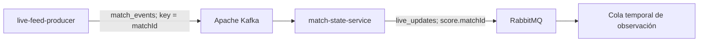

# Live Sports Platform — VAR Enabled

## 1. Portada técnica

**Fase 7: pruebas de integración. Responsable: DEV 1.**

Microservicios: `live-feed-producer` y `match-state-service`, ubicados exclusivamente en `services/`.

Ejecución real documentada: **14 de noviembre de 2026, 19:12:09–19:12:13, America/Bogota (UTC−05:00)**. Los mensajes llevan fechas UTC del 15 de noviembre, equivalentes al día 14 en Bogotá. Resultado técnico: **EXITOSA para el flujo y la secuencia descritos**. El cierre de la Fase 7 permanece pendiente de aprobación.

## 2. Introducción

La integración comprueba que los eventos deportivos atraviesan los adaptadores y los brokers y producen actualizaciones observables del marcador. En una arquitectura distribuida, las pruebas de dominio y los transportes simulados no demuestran por sí solos publicación, serialización, consumo y entrega reales.

Se distinguen las pruebas automatizadas anteriores de la Fase 7A y la ejecución con brokers reales de la Fase 7B. Esta documentación no introduce nuevas ejecuciones.

## 3. Objetivos

Objetivo general: comprobar el flujo real de eventos y actualizaciones de marcador de los dos servicios de DEV 1.

Objetivos específicos:

- Verificar publicación y lectura en Kafka con clave igual al identificador del partido.
- Comprobar deserialización, registro explícito del partido y procesamiento del consumidor.
- Observar JSON entregado en RabbitMQ mediante una cola temporal enlazada al exchange.
- Validar goles, revisión VAR, anulación y continuación del partido.
- Verificar que dos repeticiones exactas no alteran el marcador ni producen publicaciones adicionales.
- Separar los resultados comprobados de las garantías de recuperación y de las integraciones pendientes.

## 4. Arquitectura y alcance



El dominio del productor crea `MatchEvent`; el puerto `MatchEventPublisher` lo publica mediante `KafkaMatchEventPublisher`. El adaptador serializa en snake_case, usa el `matchId` como clave y espera la confirmación de Kafka.

`KafkaMatchEventListener` deserializa mediante `MatchEventMessage`, valida la clave y delega al puerto de procesamiento. `MatchStateService` aplica las reglas del agregado `MatchState`. El estado, la deduplicación y la outbox son locales a `InMemoryMatchStateStore`. `ProcessAndPublishMatchEvent` coordina el procesamiento y la publicación de pendientes.

`RabbitScoreUpdatePublisher` publica JSON y espera publisher confirms, comprobando también devoluciones por falta de ruta. El consumidor Kafka utiliza confirmación por registro y commits síncronos. Esto describe la coordinación implementada; no constituye una transacción distribuida ni una garantía de exactly-once después de fallos.

En la prueba real, un ejecutor externo abrió **los dos contextos Spring existentes en un único proceso Java**, en modo sin servidor web. Invocó el bean real del productor; el consumidor recibió los eventos a través de Kafka. Un consumidor Kafka independiente observó registros y una conexión AMQP leyó la cola temporal. No se usaron mocks en este recorrido. No se verificó el despliegue de los servicios como procesos independientes.

Referencias de código y configuración:

- [POM del productor](../../live-feed-producer/pom.xml) y [POM del consumidor](../pom.xml).
- [Configuración del productor](../../live-feed-producer/src/main/resources/application.properties) y [configuración del consumidor](../src/main/resources/application.properties).
- [Adaptador Kafka productor](../../live-feed-producer/src/main/java/com/live_jgv/live_feed_producer/infrastructure/kafka/KafkaMatchEventPublisher.java).
- [Listener Kafka](../src/main/java/com/live_jgv/matchstate/infrastructure/kafka/KafkaMatchEventListener.java) y [configuración de mensajería](../src/main/java/com/live_jgv/matchstate/infrastructure/config/MessagingConfiguration.java).
- [Almacenamiento en memoria](../src/main/java/com/live_jgv/matchstate/infrastructure/memory/InMemoryMatchStateStore.java) y [publicador RabbitMQ](../src/main/java/com/live_jgv/matchstate/infrastructure/rabbit/RabbitScoreUpdatePublisher.java).

## 5. Tecnologías confirmadas

| Tecnología | Versión documentada | Fuente |
|---|---|---|
| Java | Compilación Java 17; ejecución Temurin 17.0.20.1 | Ambos POM; propiedades de los XML Surefire; log de arranque real |
| Spring Boot | 3.5.7 | Parent de ambos POM y banner del log real |
| Maven | 3.10.0 | Salida `mvn -version` de la preparación; no fijado mediante el POM |
| Apache Kafka | Broker 3.9.1 | Imagen `apache/kafka:3.9.1`, log del broker e informe de ejecución |
| RabbitMQ | 4.1.0 | Imagen `rabbitmq:4.1.0` y salida de plugins conservada en la sesión |
| Docker | Engine 29.9.3; Desktop 4.99.0; Compose 5.7.0 | Salidas de diagnóstico de preparación; Compose no inició estos brokers |
| JUnit Jupiter | 5.12.2 | Classpath de los XML Surefire anteriores |
| Mockito | 5.17.0 | `mockito-core` y `mockito-junit-jupiter` en los XML Surefire |

Las versiones de las herramientas del host proceden de las salidas anteriores de la sesión; no fueron consultadas nuevamente al redactar este documento. Los POM declaran `spring-boot-starter-test`; las versiones efectivas de JUnit y Mockito se verificaron en los informes existentes, sin ejecutar pruebas nuevas.

## 6. Configuración utilizada

| Componente | Parámetro | Valor |
|---|---|---|
| Kafka | Contenedor existente | `fase7b-kafka` |
| Kafka | Bootstrap del host | `127.0.0.1:19092` → puerto interno `9092` |
| Kafka | Topic / particiones | `match_events` / 1, partición observada 0 |
| Kafka | Consumer group del servicio | `match-state-service` |
| Kafka | Clave observada | `match-001` |
| Kafka | Listeners | `PLAINTEXT://:9092`, `CONTROLLER://:9093` |
| Kafka | Advertised listener | `PLAINTEXT://127.0.0.1:19092` |
| RabbitMQ | Contenedor existente | `fase7b-rabbit` |
| RabbitMQ | AMQP del host | `127.0.0.1:15673` → puerto interno `5672` |
| RabbitMQ | Exchange | `live_updates`, tipo `topic`, durable |
| RabbitMQ | Patrón / routing key observada | `score.{matchId}` / `score.match-001` |
| Partido | Match ID | `match-001` |
| Partido | Local / visitante | `team-home` / `team-away` |

Los identificadores son cadenas no vacías compatibles con el dominio y las propuestas de contrato. Los equipos son distintos y corresponden al partido configurado. Los eventos nuevos utilizan UUID; los duplicados conservan exactamente el identificador y el payload original. VAR y anulación referencian el UUID del gol visitante.

El registro se realizó con `MATCH_ID`, `HOME_TEAM_ID` y `AWAY_TEAM_ID`, resueltos por `match-state.matches[0]` en `application.properties`; no hubo valores añadidos al Java de producción. Se utilizaron credenciales locales existentes, suministradas externamente y omitidas de este documento.

RabbitMQ respondió `Ping succeeded`; Kafka atendió operaciones reales desde el host. Ambos contenedores estaban en ejecución al finalizar, sin healthcheck Docker configurado. La administración web RabbitMQ no estaba habilitada ni publicada: `15672` no era accesible. El listener interno Prometheus `15692` no es la consola de administración.

El [Compose compartido](../../../docker-compose.yml) contiene `services: {}`; no se modificó ni se utilizó para esta ejecución.

## 7. Pruebas automatizadas anteriores: Fase 7A

| Servicio | Pruebas | Fallos | Errores | Omitidas |
|---|---:|---:|---:|---:|
| live-feed-producer | 43 | 0 | 0 | 0 |
| match-state-service | 73 | 0 | 0 | 0 |
| **Total** | **116** | **0** | **0** | **0** |

Proceden de los XML Surefire anteriores y de su resumen conservado, generado después de estos comandos:

```powershell
mvn -f services/live-feed-producer/pom.xml clean verify
mvn -f services/match-state-service/pom.xml clean verify
```

Ambos terminaron en `BUILD SUCCESS`. El primer intento bajo las restricciones del entorno no pudo acceder al repositorio Maven local; la repetición con acceso autorizado completó las verificaciones. **No se repitieron durante la ejecución real de la Fase 7B ni durante esta documentación.**

Incluyen pruebas de dominio, contratos propuestos, adaptadores y contexto. `MessagingPipelineTest` usa transporte RabbitMQ simulado; no equivale a una prueba con brokers. Los tests de contexto del consumidor desactivan el listener Kafka y la declaración dinámica RabbitMQ. Los logs de confirmación que aparecen en esos tests no acreditan entrega real. La evidencia real es la de la sección siguiente.

## 8. Secuencia real y resultados

Estado inicial: contexto nuevo, partido registrado con marcador 0-0 y topic nuevo. No se reinició el consumidor durante la secuencia.

| Offset | Evento | ID | Marcador | Mensajes RabbitMQ | VAR |
|---:|---|---|---|---:|---|
| 0 | GOAL local | G1 | 1-0 | 1 | CLEAR |
| 1 | GOAL local duplicado | G1 | 1-0 | 0 | CLEAR |
| 2 | GOAL visitante | G2 | 1-1 | 1 | CLEAR |
| 3 | VAR_CHECK | V1 | 1-1 | 1 | IN_PROGRESS |
| 4 | GOAL_ANNULLED | A1 | 1-0 | 1 | CLEAR |
| 5 | GOAL_ANNULLED duplicado | A1 | 1-0 | 0 | CLEAR |
| 6 | MATCH_CONTINUES | C1 | 1-0 | 1 | CLEAR |

Identificadores reales:

| Alias | UUID | Minuto | Referencia |
|---|---|---:|---|
| G1 | `00a6fa93-3f61-4c5b-8cb5-59c25cf3b021` | 10 | null |
| G2 | `7f320bfd-72ac-4f74-a588-d04e33b7f6d5` | 20 | null |
| V1 | `5a6397b3-f299-4c89-94b0-db1d167cbc74` | 21 | G2 |
| A1 | `1b975025-062a-4a45-9bd4-264b8e983e6c` | 22 | G2 |
| C1 | `d2ab559d-d2f9-4dda-8494-1938647c0d3d` | 23 | null |

## 9. Resultados de mensajería

- 7 publicaciones Kafka confirmadas por el adaptador del productor.
- 7 registros Kafka observados por un consumidor independiente, en partición 0, offsets 0–6, todos con clave `match-001`.
- 7 procesamientos completados por `KafkaMatchEventListener`; sin rechazo por partido desconocido o deserialización.
- Offset confirmado final del grupo `match-state-service`: **7**, siguiente posición después del offset 6.
- 5 publicaciones RabbitMQ confirmadas y 5 mensajes JSON recibidos efectivamente mediante AMQP.
- 2 duplicados exactos procesados sin nueva publicación ni cambio adicional del marcador.

El ejecutor esperó el commit del grupo antes de comprobar estado y cola en cada paso. Verificó identificadores, marcador, routing key y content-type `application/json`. La cola temporal `amq.gen-zyS-6qMr_fpy59h85V5BBA` era exclusiva, no durable y auto-delete. Desapareció al cerrar su conexión; la inspección final no devolvió colas. El topic, grupo, exchange, imágenes y contenedores se conservaron.

## 10. Evidencias y trazabilidad

Se conserva un [extracto permanente de evidencias reales](FASE_7_EVIDENCIAS.md), sin ejecutores, binarios ni credenciales. Contiene las líneas originales de publicación/consumo, los siete registros Kafka, los cinco mensajes RabbitMQ y el resumen Surefire por suite.

Fuentes originales inspeccionadas: `informe.md`, `evidence.txt` y `result.json` de la ejecución; `surefire-summary.json` anterior; XML Surefire y código actual de ambos módulos. Los originales permanecen fuera del repositorio, bajo `C:\Live-JVG-Fase7B-Temp`; esa ubicación es procedencia histórica, no un requisito permanente de reproducción.

Fragmentos originales relevantes:

```text
Kafka publication acknowledged; eventId=00a6fa93-3f61-4c5b-8cb5-59c25cf3b021, topic=match_events, partition=0, offset=0
Kafka event handling completed; eventId=1b975025-062a-4a45-9bd4-264b8e983e6c, partition=0, offset=5
RabbitMQ publication acknowledged; eventId=d2ab559d-d2f9-4dda-8494-1938647c0d3d, exchange=live_updates, routingKey=score.match-001
REAL_PIPELINE_PASS kafka=7 consumed=7 rabbit=5 final=1-0
```

Mensaje RabbitMQ original de anulación:

```json
{"match_id":"match-001","home_score":1,"away_score":0,"event_id":"1b975025-062a-4a45-9bd4-264b8e983e6c","event_type":"GOAL_ANNULLED","updated_at":"2026-11-15T00:12:12.815787600Z","var_status":"CLEAR","reference_event_id":"7f320bfd-72ac-4f74-a588-d04e33b7f6d5"}
```

## 11. Problemas encontrados y tratamiento

| Situación | Evidencia y tratamiento |
|---|---|
| Configuración inicial de partidos vacía | El contexto anterior registró `configuredMatches=0`. El servicio exige registro previo; no se afirma que hubiera rechazos reales en la secuencia exitosa. Se configuraron las tres variables externas y el contexto real registró `configuredMatches=1`. |
| Docker inicialmente detenido y Compose vacío | Se inició Docker Desktop durante la preparación y se crearon brokers locales aislados. La ejecución controlada reutilizó esos contenedores; no modificó el Compose. |
| Listado Kafka desde dentro del contenedor | El broker anuncia `127.0.0.1:19092` para el host. Dentro del contenedor esa dirección no alcanza el puerto publicado del host. Se verificó acceso desde el host con clientes reales, sin cambiar infraestructura. |
| Avisos `NOT_COORDINATOR` | Siete avisos transitorios durante el establecimiento del grupo; redescubrimiento automático y procesamiento posterior correcto. No se observó pérdida en esta secuencia. |
| Temporales en `target/fase7b` raíz y copias en `docs/fase7b` | Preparación incorrecta; se inspeccionaron, copiaron y verificaron por hash los tres archivos útiles en una carpeta externa y se eliminaron únicamente los temporales autorizados. Se preservaron los `target/` internos. La ejecución real posterior generó todos sus artefactos fuera del repositorio. |

## 12. Limitaciones explícitas

- Estado de partidos, deduplicación y outbox en memoria; no se implementó persistencia nueva.
- No existe recuperación garantizada después de reiniciar el consumidor. No se hicieron pruebas de recuperación ni reinicios durante la secuencia. Al cerrar los contextos al terminar, el estado local se perdió y los offsets Kafka permanecieron.
- No se demuestra entrega exactly-once ante caídas, fallos de red o reinicios.
- Los [contratos compartidos](../../../contracts/events/) siguen vacíos y pendientes de aprobación. Existen [propuesta de entrada](../../live-feed-producer/docs/match-event.schema.proposed.json) y [propuesta de salida](score-update.schema.proposed.json). Se comprobó interoperabilidad JSON del flujo observado, no conformidad con un contrato compartido aprobado ni validación JSON Schema completa.
- No se ejecutaron endpoints REST. `MatchSimulationController` está vacío y `MatchSimulationService` no contiene implementación; se invocó el puerto real del productor desde el ejecutor externo.
- No se verificó integración completa con DEV 2 o DEV 3, despliegue independiente, carga, múltiples particiones, réplicas o múltiples consumidores.
- La duplicación comprobada conserva el mismo UUID y payload. No equivale a reenviar una anulación con otro UUID: ese caso tiene reglas diferentes y no fue parte de la prueba real.
- La cola observadora fue temporal y sus mensajes se leyeron con auto-ack; su recepción no representa almacenamiento duradero de un consumidor final.

## 13. Conclusiones

El flujo real del productor al consumidor a través de Kafka y desde el consumidor a RabbitMQ quedó comprobado para los siete envíos y cinco actualizaciones descritos. La clave Kafka, referencias VAR, deserialización, registro externo del partido, commits y routing RabbitMQ produjeron el marcador final 1-0. Los dos duplicados exactos no generaron actualizaciones adicionales.

La evidencia no permite extender esta conclusión a recuperación, persistencia, contratos aprobados ni integración global de todos los equipos. La Fase 7 permanece pendiente de aprobación de cierre.

## 14. Reproducción

### 14.1 Pasos ejecutados históricamente

Se inspeccionaron `docker ps`, `docker port` de ambos contenedores, listeners, plugins, usuarios sin divulgar contraseñas, logs Kafka y puertos TCP del host. Se ejecutaron `rabbitmq-diagnostics -q ping` y `rabbitmq-diagnostics -q listeners`.

Los JAR existentes se extrajeron en un directorio externo para construir el classpath. El ejecutor temporal se compiló con `javac -cp` y se lanzó con `java -cp`; abrió los contextos existentes con `SpringApplicationBuilder` y `WebApplicationType.NONE`, cargando explícitamente el `application.properties` de cada módulo. Creó un topic nuevo, declaró el exchange y enlazó la cola observadora antes de enviar eventos. No se ejecutaron comandos Maven durante esa secuencia.

Se comprobaron los commits con `AdminClient.listConsumerGroupOffsets`, los registros con `KafkaConsumer`, el estado con `InMemoryMatchStateStore.findById` y la recepción con AMQP `basicGet`. Al terminar se inspeccionaron `rabbitmqctl list_queues`, `rabbitmqctl list_exchanges` y Git.

### 14.2 Procedimiento propuesto para una futura ejecución

Estos pasos son instrucciones; **no se ejecutaron al redactar la documentación**. No requieren ninguna ruta personal. El repositorio no distribuye el ejecutor temporal; una reproducción automatizada requiere preparar un equivalente externo o incorporar en otra tarea autorizada una prueba de integración dentro del módulo Maven. No existe actualmente un comando único del repositorio que reproduzca todo el escenario.

1. Desde la raíz del repositorio, disponer de Java 17, Maven y los dos JAR compilados. Si se necesita regenerarlos, ejecutar los dos `clean verify` de la sección 7; sus salidas permanecen en los `target/` de cada módulo.
2. Inspeccionar los brokers existentes, sin recrearlos, reiniciarlos ni eliminar recursos:

   ```powershell
   docker ps
   docker port fase7b-kafka
   docker port fase7b-rabbit
   docker exec fase7b-rabbit rabbitmq-diagnostics -q ping
   docker exec fase7b-rabbit rabbitmq-diagnostics -q listeners
   ```

3. Configurar las variables externas en la sesión del ejecutor:

   ```powershell
   $env:MATCH_ID = 'match-001'
   $env:HOME_TEAM_ID = 'team-home'
   $env:AWAY_TEAM_ID = 'team-away'
   $env:KAFKA_BOOTSTRAP_SERVERS = '127.0.0.1:19092'
   $env:MATCH_EVENTS_TOPIC = 'match_events'
   $env:SPRING_KAFKA_CONSUMER_GROUP_ID = 'match-state-service'
   $env:KAFKA_LISTENER_AUTO_STARTUP = 'true'
   $env:RABBITMQ_HOST = '127.0.0.1'
   $env:RABBITMQ_PORT = '15673'
   $env:RABBITMQ_EXCHANGE = 'live_updates'
   ```

   Proporcionar `RABBITMQ_USERNAME` y `RABBITMQ_PASSWORD` por un mecanismo local seguro; no incluir sus valores en documentación, comandos registrados o archivos versionados.

4. Resolver primero el estado inicial. El topic y los offsets de la ejecución histórica permanecen. **No lanzar el ejecutor histórico sin cambios**: intenta crear un topic existente y falla. Un consumidor nuevo con estado vacío tampoco recupera el marcador por conservar offsets. Para repetir en los mismos brokers sin borrar datos, usar un topic y grupo exclusivos de la nueva ejecución mediante las variables existentes y parametrizar con esos mismos nombres el observador y el ejecutor externo. Registrar el cambio respecto de `match_events` y `match-state-service`; los offsets comenzarán en 0 solo si el topic es nuevo. Reproducir exactamente esos nombres requiere una preparación aislada adicional autorizada; no resetear ni borrar recursos existentes como paso implícito.
5. Preparar el ejecutor únicamente en un directorio externo creado, por ejemplo, bajo `[IO.Path]::GetTempPath()`. Leer los dos JAR existentes con `System.IO.Compression.ZipFile`, extrayéndolos allí; no crear módulos Spring nuevos. El classpath incluye los dos `BOOT-INF/classes` y `BOOT-INF/lib/*`. Compilar y ejecutar allí, conservando los logs fuera del repositorio. Cargar explícitamente la configuración de cada servicio para evitar la ambigüedad de dos `application.properties` en el mismo classpath.
6. El ejecutor debe usar `MatchEventPublisher` del contexto del productor y el listener Kafka existente del consumidor. Crear UUID nuevos para cinco eventos: GOAL local (minuto 10), GOAL visitante (20), VAR_CHECK (21, referencia al gol visitante), GOAL_ANNULLED (22, misma referencia), MATCH_CONTINUES (23). Publicar en el orden G1, G1, G2, V1, A1, A1, C1; reutilizar los mismos objetos G1 y A1 para conservar todo el payload de los duplicados. No publicar directamente con herramientas Kafka sustituyendo al productor.
7. Antes del primer envío, declarar una cola AMQP exclusiva temporal enlazada a `live_updates` con `score.match-001`. Para cada envío, esperar confirmación del productor, observar el registro Kafka y su clave, esperar el commit real del grupo y contrastar el marcador en memoria con la tabla. Leer y validar el JSON RabbitMQ; exigir ausencia de mensajes en los dos duplicados y cola vacía al terminar. El patrón histórico usó espera acotada de hasta 30 segundos por evento y consulta de offsets cada 100 ms.
8. No reiniciar el consumidor durante la secuencia. Ante fallos, detenerse y preservar evidencias antes de proponer cambios. Registrar resultados reales, cerrar los contextos y la conexión exclusiva para retirar solo la cola temporal. No eliminar topic, grupos, exchange, contenedores ni volúmenes como limpieza automática.

## 15. Higiene del repositorio y validación documental

El [.gitignore raíz](../../../.gitignore) ya cubre `**/target/`, `*.class`, `*.log`, `*.tmp`, `*.bak`, `*.temp`, directorios temporales y de integración, `.env` y `.env.*`, preservando `.env.example`. No se modifica en esta tarea. La modificación pendiente de `.gitignore` procede de la tarea anterior de higiene y se conserva.

Esta entrega añade únicamente este documento y el extracto de evidencias enlazado. No añade ejecutores, código Java ni artefactos compilados. Se verifican enlaces locales, correspondencia de conteos e identificadores con las fuentes, ausencia de credenciales y `git diff --check`. No se ejecutan pruebas nuevas ni se modifica producción, Compose o contratos compartidos. No se realizan commits ni push; la publicación en GitHub queda pendiente de aprobación.
